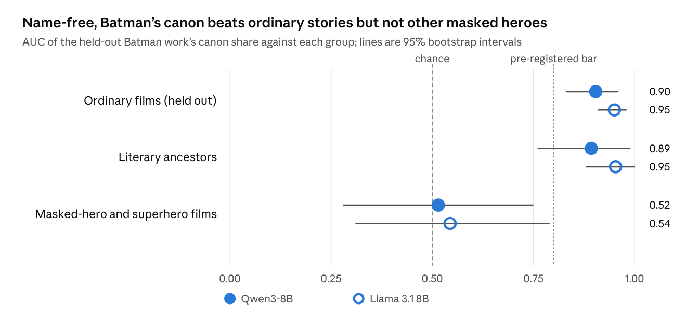
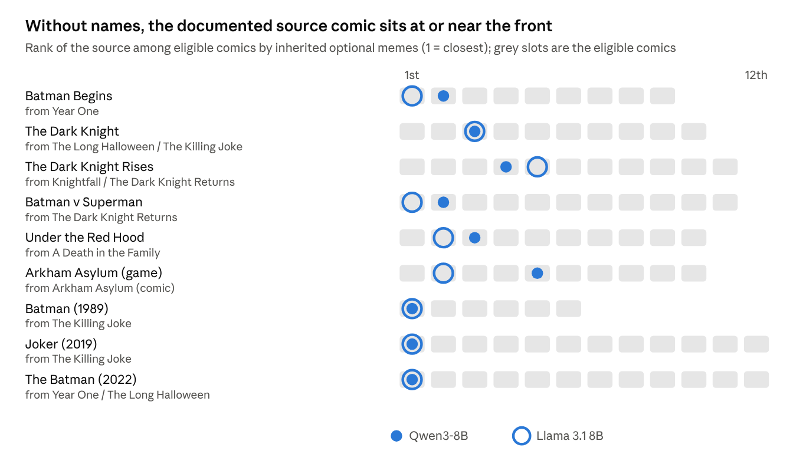

# Can Creativity Be Reverse-Engineered? Language-model neurons as units of cultural inheritance in 80 years of Batman

Mike Taylor and Claude Opus 5.5 (Anthropic) · 20 October 2026

## Abstract

Memetics stalled because no one could say where one meme ends and the next begins. Recent interpretability work suggests a candidate: Cammarata argues that most neurons in modern language models are already clean, each with one main job, often a single concept or trope. We test the proposal that follows: define a meme as whatever makes a single neuron inside an artificial neural network fire. In Qwen3-8B we recorded 884,736 neuron poles across Wikipedia plot summaries of 32 Batman works (1943–2022), 13 literary and superhero relatives, and 69 ordinary films. Merging neurons that fire on the same sentences gave 14,843 meme families. Fifty-six form a core canon present in at least 29 of the 32 works, and random 32-film pseudo-franchises have no such core.

We ran three pre-registered experiments on name-free texts. Heredity was supported in both models: adaptations carry their documented source comic's optional units more than other comics' (16% and 10% of eligible comics beat the source, against 47% by chance; exact p = 0.0026 and 0.00017). The pattern holds in 99.6% of 30,240 analysis specifications. Plain word overlap finds the sources as well as the neurons do. The pre-registered test of whether the neurons add anything beyond shared words fails for Qwen (p = 0.09 to 0.25) and passes for Llama 3.1 8B (p = 0.010 to 0.033). Identity was not supported. Without names, the share of Batman's canon a work carries separates Batman from ordinary stories (AUC 0.90 to 0.95) but not from masked-hero films (0.52 to 0.54). That null comes from the scoring rule: a word-based centroid separates them at 0.80, through a crime-city vocabulary. The name-free core (a secret identity, an origin in loss, a costume, a mission by night) is close to the standard definition of a superhero. Selection was not detected, in a test with little power.

The strongest units have twins in Llama 3.1 8B, trained by a different company (median r = 0.82). Most of them detect names and words. Word-like units that are not memes have twins about as good, and without names the agreement collapses. Concept memes keep a narrower advantage on the original texts. Only a few units, such as a funeral, a coin flip and Llama's revenge unit, clearly survive rewording.

Neuron units make cultural heredity measurable, inspectable and nameable. On this corpus they trace it about as well as word counts do. Whether they see more than words must be shown on lineages where shared wording cannot carry the signal.

## 1. Introduction

Cultural evolution borrowed the gene's logic but never found its gene. Dawkins proposed the meme as the unit of cultural inheritance in 1976 [1], and the idea spread faster than any method for testing it. Two decades later the field's own stock-take asked whether memetics was a science at all [2]. The recurring answer was that no one could say where one meme ends and the next begins, so no one could count memes, track their copying, or measure their fitness [3]. Cultural evolution research moved on without the unit, studying traits that could be coded by hand [4].

This study began with a recent claim from interpretability research. In "Neural networks are already clean", Cammarata argued that most neurons in modern language models such as Qwen3 already have one main job, often as specific as a feeling or a narrow trope, and that the apparent mess of earlier models came from fixable training and tooling problems rather than from superposition [10]. If that is right, a neuron is a ready-made, inspectable and testable unit, and memetics has the definition it lacked: a meme is whatever makes a given neuron fire. The rest of this introduction sets out why such a unit is needed and what it has to beat.

The obstacles are specific. Concepts like "Batman" lack objectively measurable properties, and people hold different versions of them, so there is no agreed place to look for a "Batman meme" and no way to check that two people carry the same one. Members of a meme family such as the Scarlet Pimpernel, Zorro, Batman and Iron Man differ in more ways than they agree, so rule-based coding struggles to group them. Without a rigorous definition, memes cannot be categorised at scale, used for testable predictions, or measured without slow and error-prone human labelling. In that sense memetics is still pre-Mendel: no one has traced the inheritance of thousands of memes.

Hand-coded traits have carried that work a long way. Tehrani reconstructed the family tree of Little Red Riding Hood from coded plot features [5], and da Silva and Tehrani coded which international tale types each of 50 Indo-European populations tells, then used comparative phylogenetic methods to trace some tales to the Bronze Age [6]. The trait list in those studies comes from folklorists' indexes. It is reliable and expert, but it is fixed in advance, coarse, and costly to extend to a new body of stories.

Other work traces inheritance from the words themselves, with no hand-coded list. Barbrook and colleagues built a family tree of the manuscripts of *The Canterbury Tales* from their copying variants [21]. Chavalarias and Cointet rebuilt the branching lineages of scientific fields from the terms their papers share, and called the result phylomemetic [19]; this project uses the same word for a different method. Kuhn, Perc and Helbing found scientific memes, words and phrases that are inherited along citation links, with no linguistic knowledge [20]. In stories, film remakes can be matched from their Wikipedia plot summaries [22], and summaries of the same story become much harder to match once their names are replaced [23]. Word-based units like these are automatic too. So the question for any new unit is what it finds that words miss.

Language models offer a candidate unit that is neither fixed in advance nor hand-coded. Interpretability research has found single neurons that respond to one concept across many surface forms, including a Spider-Man neuron in CLIP that fires for photographs, drawings and the written name [7], much like the concept cells recorded in the human brain [18]. Neurons with similar jobs recur across separately trained models [8], and different models' representations appear to converge as they scale [9]. Automatic descriptions now exist for every MLP neuron of Llama 3.1 8B Instruct [24], one of the models used here, and features learned from text embeddings have been used to find and name the properties of texts that predict an outcome [25]. Cammarata's claim that most such neurons are already clean [10] is what would make them usable as a list of traits. This paper puts that idea into practice, treating Batman as a basket of associated memes.

We test that proposal on one long, well-documented lineage: Batman, from the 1943 film serial to The Batman (2022), alongside literary and superhero relatives from Puss in Boots (1697) to The Green Hornet (2011). Batman is a convenient model organism. Its lineage is long and branching, many works state their sources, and fans and critics have argued for decades about what is and is not canon.

We ask three questions, matching the three things a science of memes needs. Identity: is there a set of neuron-defined memes that a story must carry to be Batman, and does it survive when every name is removed? Heredity: do adaptations carry the optional memes of their documented source comics more than those of other comics? Selection: do memes carried by popular early works spread further into later ones? Alongside these we ask whether the units are shared by two language models from different companies, whether they respond to ideas or only to particular words, and whether they find anything that plain word overlap does not.

## 2. Material and methods

### 2.1 Corpus

We used the plot sections of English Wikipedia articles, keeping the first 40 sentences of each. These retellings were written by people. The lineage comprises 32 Batman works from 1943 to 2022: 13 live-action films and serials, 12 comics, 4 animated films and 3 video games. The comparison set has 13 relatives ("cousins"). Five are literary ancestors: Puss in Boots, The Count of Monte Cristo, A Study in Scarlet, Dracula and The Scarlet Pimpernel. Eight are masked-hero or superhero films: The Bat (1926), The Mark of Zorro (1940), The Shadow, Superman, Spider-Man, Daredevil, Iron Man and The Green Hornet. A background pool of 69 popular films with no superheroes sets the bar against which every meme is measured. Three works were dropped because their plot sections had fewer than 8 sentences (the 1949 serial Batman and Robin, the Moon Knight miniseries and Pulp Fiction). The corpus has 3,700 sentences.

A name-free version of every text was built in two steps. A language model (Claude) rewrote each summary with proper names replaced, and a second pass checked the rewrite. The rewrite was used only to locate the names: a word-level diff against the original marked each changed span, and each span was replaced with a neutral code (X1, X2, and so on, consistent within a work). In all, 9,156 spans were replaced. This removes the role words the rewriter chose, such as "the vigilante" (used 366 times in the Batman rewrites, 16 times in the cousins and never in the ordinary films), which would otherwise leak identity.

### 2.2 Models and units

The main model is Qwen3-8B [11]. Llama 3.1 8B Instruct [12], trained by a different company on different data, is the independent second opinion, and Qwen3-1.7B is a smaller model from the same family. All ran locally at 4-bit precision with MLX. A unit is one channel of a feed-forward block's hidden layer (the SwiGLU product that feeds the down-projection). Because a channel's sign is arbitrary, its positive and negative extremes are treated as separate units, following [10]. That gives 884,736 units in Qwen3-8B, 917,504 in Llama 3.1 8B and 344,064 in Qwen3-1.7B. For each unit we recorded its strongest response in every sentence, with each text processed as one continuous document.

### 2.3 Presence, memes and canon

A work's score on a unit is the mean of its three strongest sentences. A unit is present in a work when that score beats all but one of the reference films, so an ordinary story crosses the bar about 3% of the time by chance. Candidate memes are units present in at least 6 of the 32 Batman works (18,485 in Qwen3-8B). Units that fire on the same sentences (correlation of at least 0.5, average linkage) were merged into 14,843 meme families. Families were named by reading the eight sentences each fires on most strongly, and every name was checked by a second, sceptical reader. The names were tested blind on new sentences (Section 2.6) but not validated by steering.

Canon tiers follow the share of Batman works a meme appears in: core (at least 90%, 29 or more works), common (70 to 89%) and optional (19 to 69%). A meme is Batman-specific if it appears in at most 3 of the 13 cousins, and shared with the genre otherwise.

### 2.4 Trees, overlap between models and rewording

Works were compared by the Jaccard distance between their sets of memes, and trees were built by neighbour-joining [13], rooted on the oldest work (Puss in Boots). Agreement between two models' trees is the Mantel correlation of their distance matrices [14]. For each Qwen meme, its twin in another model is the unit whose responses across the 3,700 sentences correlate most strongly with it. There are two baselines: the same search for active Qwen units that were not selected as memes, and the same search with sentences shuffled. Agreement on the meme grid is the share of meme-by-work cells marked the same way, with Cohen's kappa [15].

To test whether units respond to ideas rather than words, the top sentence of each of 31 named memes was rewritten to share almost no content words with the original (none in 28 of 31; one common word in the other three). A unit still fires if it responds more strongly to the rewording than to any of ten everyday sentences. Separately, each model's revenge unit was chosen from the 41 corpus sentences that use revenge words, among 50 candidates, on 10 practice pairs that use no such words. It was then scored on 12 new minimal pairs, in which a revenge sentence is matched with the same sentence made harmless.

### 2.5 Three pre-registered experiments

The designs below were revised after an adversarial review by three independent AI reviewers, before the experiments were run. Each names one primary test, with Qwen3-8B as the primary model and Llama 3.1 8B as the replication. One reviewer had probed the original-text version of E2 on Qwen3-1.7B, so the plan states that the decisions rest on the name-free texts only. E2's frequency band and hub adjustment were chosen after an earlier, simpler heredity test on the meme trees had failed (Section 3.4). The multiverse in Section 3.8 checks whether those choices made the result.

**E1, identity.** For each Batman work, canon units are those present in at least 80% of the other 31 works (original texts). The held-out work is scored by the share of canon units present in its name-free text. The reference films are split in half 20 times: one half sets the presence bar, the other half is scored. Primary comparison: Batman against the 8 masked-hero and superhero film cousins, scored with the same fold's canon. Prediction: AUC of at least 0.80, a bootstrap 95% lower bound of at least 0.65, and an AUC above the 95th percentile of a label-shuffle null, in which 32 of the 40 works are drawn at random to play the franchise. Controls: the original-text ceiling; canon chosen on name-free texts; dropping every name-free sentence that still contains an iconography word (bat, cape, clown, cave, signal, asylum and so on); text length alone; a TF-IDF centroid score on the same name-free texts; held-out ordinary films; literary cousins; and the same core procedure run on random 32-film pseudo-franchises.

**E2, heredity.** Nine adaptations have a documented source comic in the corpus, and 12 comics are available. Optional units are those present in 2 to 16 of the 32 Batman works. For adaptation A and comic C, the inheritance rate is the share of C's optional units also present in A. It is z-scored against the same rate in the 11 Batman screen works that adapt no comic, which corrects for comics that resemble everything. Only comics published no later than A are eligible. The statistic is the share of eligible comics that beat the documented source (the best of its sources), averaged over the adaptations, and it is tested against a permutation that relabels comic identities jointly (10,000 draws). Positive control: on name-free texts, each of 7 sequels should rank its prequel among the top 2 earlier screen works for at least 5 of 7. If it fails, the comic test is inconclusive rather than falsified. Controls: placebo targets (each of the 11 non-adaptation screen works given every documented source set; the real value must fall below their 5th percentile), the original-text upper bound, raw and expectation-corrected rates, no time rule, mean-of-sources and first-listed-source rules, a strong-attribution subset, dropping the three Killing Joke adaptations, a rewrite-batch check, and three alternative frequency bands. Word comparators: the same test with TF-IDF cosine and with binary word presence on the same name-free texts. Residual test: across the 32 × 12 work-by-comic pairs, regress neuron inheritance on word similarity, then rerun the test on what is left. The plan keeps two claims apart: that memes descend, by any measure, and that the neurons add something beyond shared words, which only the residual test can show.

**E3, selection.** Popularity is the mean monthly English Wikipedia pageviews from July 2015 to September 2026. The early set is the 15 Batman works before 2000. The later set is the 17 from 2000 onward, minus the 8 that adapt a comic, which removes the circular route by which fame follows adaptation. For units present in 2 to 80% of early works, a unit's later share is residualised on its early prevalence. Each early work's offspring score is the mean residual over its units, residualised in turn on the work's year, plot length and centrality. The primary test is the Spearman correlation of offspring with log popularity, with popularity permuted within medium (screen or comic, 10,000 draws), predicted positive at one-sided p < 0.05 and with the same sign in Llama. Placebos: the same test run backward in time, and with the reference films as the outcome.

**Deviations from the plan.** The main differences from the pre-registration are these. First, the word comparators for E1 and E2 and the E2 residual test were planned but left out of the first analysis. They were run after the review and are reported here. Second, under the time rule two of the 11 placebo targets, the 1943 serial and Batman '66, have no eligible comic. The first analysis scored them as perfect matches. We leave them out and use the 9 valid targets. With all 11, as written, the placebo criterion fails (5th percentile 0); with the 9 valid targets it passes. Third, two comparisons in the first analysis turned out to be fixed by construction, because the reference films set their own presence bar: the E1 core's presence in ordinary films and the E3 reference-film placebo, which the plan had defined on scores rather than presence. We do not report them. Fourth, the placeholder-unit exclusion was not run. It was written for role words such as "the vigilante", and the final name-free texts use neutral codes instead. Some smaller planned checks were also not run, among them the Qwen3-1.7B replication of E2, a band check on the original meme families, length checks on texts cut to a fixed number of sentences, and the Holm correction for E3.

### 2.6 Robustness checks

After the first analysis, a second adversarial review re-ran the work and added the checks below. Except for the E2 variants already listed in Section 2.5, none was pre-registered. All are scripts in the repository (`experiments.py` and `robustness/`).

For the meme count, random 32-film pseudo-franchises replace a binomial chance figure: in each of 50 draws, 32 ordinary films play the franchise and the other 37 set a presence bar that is applied to Batman too. Twins are compared with three nulls drawn from 30,000 random active non-meme Qwen units, matched on sparsity, on sparsity and layer, or on how well a single word reproduces the unit's profile. For the trees, the Mantel floor comes from random non-meme units, and partial Mantel tests control for TF-IDF distance and for summary length and meme counts. For rewording, a mismatched null scores each unit on another meme's rewording (10,000 derangements). For E3, power is simulated at n = 15 with the same one-sided permutation test.

The labels were tested blind. Each of 71 items gave a judge a label and two corpus sentences: one the unit fires on strongly (activation rank 9 to 30, so never one the labeller saw) and a control from the same group of works, matched for length and at or below the unit's median. The items cover the 31 named memes and 40 labels drawn at random from the larger labelled set. Blind AI judges picked the sentence. A word-overlap judge, which picks the sentence sharing more word stems with the label, gives the baseline.

E2 was rebuilt from scratch with an exact null over all 3,991,680 relabellings, run across a multiverse of 30,240 specifications, jackknifed, and tested under other nulls: relabelling comics only within their era (up to 1989, the 1990s, 2000 on), keeping every relabelled source no later than its adaptation, swapping source sets among the adaptations, and giving the source sets to random screen works.

## 3. Results

### 3.1 Memes and the canon

In Qwen3-8B, 18,485 units were present in at least 6 of the 32 Batman works. A binomial count would expect about 230 by chance, but it treats the works as independent, and they are not. Random 32-film pseudo-franchises give a fairer baseline. With the presence bar set by the other 37 films, Batman has 53,985 units in at least 6 works and the pseudo-franchises 29,400 on average, so Batman has 1.8 times as many (Llama 3.1 8B: 2.4 times). Batman is higher in all 50 draws. The core is where Batman stands apart. No pseudo-franchise has a single unit present in 23 or more of its 32 films. Batman has 1,534 (Llama: 1,914).

Merging units that fire on the same sentences gave 14,843 meme families. The count depends on the model and the merge threshold: the same procedure gives 24,732 families in Llama 3.1 8B and 5,641 in Qwen3-1.7B. Most strong families are character and place detectors (Alfred, Robin, the Joker, Gotham). Some are story patterns: the origin wound, the secret identity, taking up a hero's mantle, a funeral, a coin flip deciding a hostage's fate. A minority track Wikipedia's house style rather than story content, such as cast lists and publication history. These were labelled as such and kept, because every analysis uses all families. In the blind test, judges matched labels to new sentences 79% of the time (Section 3.8).

Fifty-six memes appear in at least 29 of the 32 works (the core canon): 24 are Batman's own and 32 are shared with the superhero cousins. A further 194 appear in 23 to 28 works, and 14,593 are optional. Most works from 1966 onward carry 90 to 100% of the core. The two lowest are the Joker-centred Joker (2019), at 55%, and The Killing Joke, at 77%, matching the 1943 serial. Among the cousins, the modern superhero films carry the most. Ancestors written before Batman's creation in 1939 carry at most 21% (The Bat, 1926). Spider-Man carries 79%, Iron Man 62%, Superman 61% and Daredevil 55%. Date is not the whole story: The Shadow (1994) carries 25% and The Green Hornet (2011) 18%.

### 3.2 What two models share

The 33 strongest Qwen memes have Llama twins that fire on the same sentences, with a median correlation of 0.82, and 70% exceed 0.7. Random non-meme Qwen units matched on sparsity reach only 0.40. By our reading of their top sentences, 24 of these 33 are name or place detectors, 3 detect common words, 4 are story concepts, 1 tracks Wikipedia style and 1 is unclear. A single word reproduces their Qwen profile at a median r of 0.85 (0.94 for the names). Non-meme units chosen to be just as word-like have twins about as good (median 0.86). Paired unit by unit, the memes are ahead by a median of 0.05 and win 25 of 33 (p = 0.007). For the names alone the gap is not significant (p = 0.07). On name-free texts the same twin pairs fall to a median of 0.14. That is no better than random units (0.23 and 0.33) and worse than word-matched units (0.56). Across all 14,843 families the median twin correlation is 0.40, against 0.36 for active non-meme units and 0.14 with sentences shuffled.

One narrower result holds up. Among the 200 strongest families, the 27 labelled as story concepts have Llama twins at a median r of 0.62 on original texts, against 0.46 for word-matched non-meme units (20 of 27 ahead, p = 0.001). With names removed and the same twin pairs, that advantage is gone (0.34 against 0.38).

For the 31 named memes, Llama's twins mark the same works present or absent in 87% of grid cells (Cohen's kappa 0.73). Random units that are present more rarely agree on even more cells (89 to 92%), because most of their cells are empty. Kappa is the fair comparison, and theirs is 0.35 to 0.57. The two models' distance matrices over the 45 Batman works and cousins correlate at 0.98. Any two representations of these texts agree closely, though: random non-meme units give 0.90 to 0.93, and TF-IDF against LSA gives 0.92. Qwen3-1.7B gives the same picture (Mantel 0.98 with Qwen3-8B; median twin r 0.40).

### 3.3 Ideas or words

When the top sentence of each named meme was rewritten to share almost no content words with the original (none in 28 of 31), 11 of 31 Qwen memes and 9 of 31 Llama twins still fired more strongly than on any of ten everyday sentences. The bar is lenient. Another meme's rewording passes a unit's bar 16% of the time in Qwen and 18% in Llama, so a mismatched-rewording null expects 5.0 and 5.7 survivors (p = 0.002 and 0.08). Few units are specific to their own rewording. Only 2 Qwen units (the funeral and Two-Face's coin) and 6 Llama units respond more to their own rewording than to any of the other 30. Four survived in both models: a funeral, Two-Face's coin flip, the secret identity and the joke. Even these stay close to words. The funeral unit tracks the word "funeral" across the corpus (r = 0.98), and its rewording uses mourners, a grave and a coffin. In Qwen, every character meme except Harvey Dent failed once the name was gone.

Llama's revenge unit (L14·3474), chosen from 50 candidates, chose the revenge sentence over its harmless twin in 10 of 12 new pairs written without revenge words. It also separated revenge from harm without retaliation (AUC 0.87) and from vows without revenge (0.79). It fired harder on "he swore to make the men who killed his father pay for what they had done" than on the same sentence with "revenge". Qwen's best revenge unit (L27·375) responded to both "revenge" and "vengeance" but was at chance without them (4 of 12). The two models' revenge units correlate only 0.39 across the corpus.

### 3.4 Trees and the vigilante lineage

All three models' trees place the three Arkham games on their own branch, place Batman v Superman beside Superman, and make The Killing Joke and Joker (2019) sister taxa. The 2019 film borrows the comic's failed-comedian origin. Qwen's tree has a camp-leaning clade (Batman '66, Batman & Robin, The Lego Batman Movie, Batman Ninja and Return of the Joker, with Batman R.I.P. and White Knight). Llama's has a grounded crime clade (Year One and The Long Halloween with the three Nolan films, Earth One and The Batman). Clustering by decade-style era labels was weak (between-era over within-era distance of 1.03 in both models, p of about 0.03): the branches follow tone more than date. The "billionaire vigilante orphan" lineage (the Scarlet Pimpernel, Zorro, Batman and Iron Man) is partly recovered. Zorro's nearest relative is the Scarlet Pimpernel in both models. After Spider-Man, Iron Man's nearest works are recent Batman films (Batman Begins and The Dark Knight Rises in Llama; Batman v Superman and Batman Begins in Qwen). Zorro itself sits far from Batman, but its summary has only 9 sentences.

The trees do not recover documented sources. Ranking the 12 comics by tree distance to each adaptation puts the documented source at a mean rank of 5.4 in Qwen and 5.3 in Llama, against 5.8 by chance (p = 0.40 and 0.36). On the same original texts, TF-IDF puts it at 2.9 (p = 0.003), and every draw of random non-meme units beats the memes (mean ranks 3.2 to 4.3). E2 uses units present in 2 to 16 Batman works, and its design came after this failure.

**Table 1.** The three pre-registered experiments. Primary model Qwen3-8B; replication Llama 3.1 8B. All tests on name-free texts.

| Experiment | Prediction | Qwen3-8B | Llama 3.1 8B | Verdict |
| --- | --- | --- | --- | --- |
| E1 Identity | AUC ≥ 0.80 vs 8 hero film cousins | 0.52 (0.28–0.75) | 0.54 (0.31–0.79) | Not supported |
| E2 Heredity | Fewer comics beat the source than chance, p < 0.05 | 16% vs 47%, p = 0.0026 | 10% vs 47%, p = 0.00017 | Supported |
| E2 Beyond words | Residual test after word overlap, p < 0.05 | p = 0.09 to 0.25 | p = 0.010 to 0.033 | Not supported in Qwen; supported in Llama |
| E3 Selection | Spearman ρ > 0, p < 0.05 | ρ = 0.25, p = 0.35 | ρ = 0.00, p = 0.58 | Not supported |

E2 p values are exact, over all 3,991,680 relabellings. 47% is the mean of the pre-registered null. Keeping every relabelled source no later than its adaptation gives 42%, and relabelling within era gives 39% (Llama 38%).

### 3.5 E1: identity

The pre-registered prediction failed. On name-free texts, the held-out work's share of canon units separated Batman from held-out ordinary films (AUC 0.90 in Qwen, 0.95 in Llama) and from the literary ancestors (0.89 and 0.95). Against the 8 masked-hero and superhero films it was at chance: 0.52 (95% CI 0.28 to 0.75) in Qwen and 0.54 (0.31 to 0.79) in Llama, inside the label-shuffle null (95th percentile 0.70 and 0.67). With only 8 negatives the interval is wide, so the test cannot show that Batman and the hero films are alike. With names the same test scores 0.996 and 0.993. Dropping iconography sentences (68 of 3,700) changed nothing (0.52 and 0.53), and neither did choosing the canon on name-free texts (0.45 and 0.60).

The null comes from the scoring rule. The pre-registered word control scores each held-out work by the TF-IDF cosine of its name-free text to the other 31 Batman works. It separates Batman from the hero films at AUC 0.80 (0.64 to 0.93). It stays at 0.78 with the canon taken from name-free texts and at 0.76 with iconography sentences dropped. Text length alone gives 0.76, because Batman summaries tend to be longer. Many of the words that weigh most describe a crime city: asylum, police, henchmen, mayor, prison, gang, hostage. So Batman's name-free summaries do differ from the hero films, and the share of canon units present does not capture the difference.

Under the canon share, the film cousins split in two. Spider-Man, Daredevil and Superman score higher than most name-free Batman stories: a Batman story out-scores them only 12%, 15% and 29% of the time in Qwen (20%, 19% and 40% in Llama), and Iron Man only 32% (50% in Llama). The older masked heroes score lower: Batman stories out-score Zorro 96% of the time, The Bat 78% and The Green Hornet 81% (Llama 100%, 98% and 72%). Each cousin is one summary, and the presence bar is set by films with no superheroes, so units for the superhero genre itself clear the bar in superhero films. These are noisy point estimates. Under the TF-IDF centroid, no hero film out-scores more than half the Batman works (Daredevil 50%, Spider-Man 31%, Superman 6%).

Only 7 of 407 Qwen canon units (Llama: 9 of 539) remain present in at least 70% of name-free Batman works. They respond to a secret identity kept by disguise, an origin in loss leading to a costume, fighting crime in costume by night, and taking up a mantle. They are present in 91% of the hero-film cousins (Llama: 74%). This is close to Coogan's standard definition of the superhero, built on a mission, powers and an identity [26]. The same procedure finds no name-free core for the cousins as a group or for random 32-film pseudo-franchises.

**Figure 1.** Without names, the share of Batman's canon a work carries separates Batman stories from ordinary films and literary ancestors, but not from masked-hero and superhero films.

### 3.6 E2: heredity

The prediction held in both models. On name-free texts, the share of eligible comics whose hub-adjusted inheritance rate beats the documented source was 16% in Qwen and 10% in Llama. Under the pre-registered joint relabelling the mean is 47%, and over all 3,991,680 relabellings the exact p is 0.0026 and 0.00017. Chance is lower once dates are respected: 42% when every relabelled source must be no later than its adaptation (p = 0.011 and 0.0006), 44% when sources are drawn evenly from the eligible comics, and 39% and 38% when comics are relabelled only within their era (p = 0.026 and 0.0014). The source beat the median non-source comic for 9 of 9 adaptations in both models. The 9 valid placebo targets (non-adaptations given the same source sets) averaged 46% and 47%, and the real values sit below every one of them.

Every pre-registered variant that was run held: with names (12% and 8%), raw rates, no time rule, the strong-attribution subset, dropping the three Killing Joke adaptations (exact p = 0.021 and 0.0016), and three alternative frequency bands. In the sequel positive control, without names Qwen recovered the prequel among the top two for 4 of 7 sequels and Llama for 5 (bar: 5). With names, the counts were 7 and 6. The control was written so that a failed comic test would read as inconclusive. It does not change a result that held, so Qwen's verdict stays "supported". It does show that the neuron measure has limited power without names, and Qwen's neurons are the weakest of the four measures on this control.

The pre-registered word comparators find the sources as well as the neurons do. With TF-IDF cosine, 11% of eligible comics beat the source; with word presence, 17%. Both pass the sequel control. The residual test, which asks whether the neurons add anything beyond shared words, fails for Qwen and passes for Llama (Section 3.8, Table 2). So the name-free summaries of adaptations carry their sources' plot content, and neuron units detect it about as well as word counts. Llama's units add a little beyond words. Qwen's add nothing we can detect.

**Figure 2.** For most adaptations the documented source is the closest or second-closest eligible comic by inherited units, in both models.

### 3.7 E3: selection

The prediction was not supported. Across the 15 pre-2000 works, the rank correlation between log monthly pageviews and the residualised spread of a work's memes into the 9 later non-adaptations was 0.25 in Qwen (p = 0.35) and 0.00 in Llama (p = 0.58). On original texts it was negative (−0.32 and −0.50), and the reverse-time placebo was near zero (−0.08 and −0.17). The test had little power. In simulation, a test of this size detects a true correlation of 0.3 only 27% of the time, and one of 0.5 only 54% of the time. This is a weak null.

### 3.8 Robustness

The checks in Section 2.6 are scripts in the repository, and every number below comes from their committed outputs. Sections 3.1 to 3.3 already use the stronger nulls for the meme count, the twins and the rewordings.

**E2 rebuilt.** An independent rebuild of E2 from the activations matched all 9 per-adaptation shares in both models and both text versions, and gave the same exact p values.

**Multiverse.** We varied the score (top 1, 3 or 5 sentences), the presence bar, the frequency band, the hub adjustment, the time rule, the source rule and de-duplication, in both models and both text versions: 30,240 specifications in all. The joint-relabelling p was below 0.05 in 30,108 (99.6%) and below 0.01 in 28,628. All 132 failures had the hub adjustment off; with it on, the largest p was 0.020. The four other nulls (within era, source swap, time-consistent source swap and random screen targets) were each significant in at least 30,194 specifications, and all five at once in 30,042. The sequel control is the weak point: on name-free texts it passes in 48% of Qwen specifications and 82% of Llama's.

**Jackknife.** On name-free texts, under the joint null, the result holds whatever is left out. Leaving out any one adaptation, any pair, any triple or any single comic keeps p below 0.05 in both models. The largest is 0.047, for Qwen with three adaptations left out. Under the stricter within-era null, Qwen is fragile: 9 of 36 pairs, 37 of 84 triples and 2 of 12 single comics left out give p of 0.05 or more (largest 0.13, without The Dark Knight Returns). Under the source-swap null, 20 of 84 Qwen triples fail (largest 0.15). Llama passes every leave-out under every null. Dropping the three Killing Joke adaptations gives a within-era p of 0.083 for Qwen and 0.008 for Llama.

**Other nulls and variants.** On name-free texts the result survives swapping the 9 source sets among the adaptations (exact p = 0.0039 and 0.00035), swapping them only within medium (0.0048 and 0.0095), giving them to random screen works (p = 0.0017 and 0.00024), and drawing sources evenly from the eligible comics (0.0019 and 0.00011). The mean-of-sources and first-listed-source rules, the expectation-corrected rate, a fuller source list and two source lists read from the saved Wikipedia articles all stay significant (largest p 0.009). Non-source pairs rewritten in the same batch inherited no more than pairs from different batches.

**Words against neurons.** Table 2 sets the neurons beside the pre-registered word comparators. TF-IDF finds the sources better than Qwen's neurons and about as well as Llama's. It also holds under the within-era null and passes the sequel control. With word similarity regressed out, Qwen's neuron inheritance no longer points to the sources. Llama's keeps a small signal under all three versions of the test. The reverse holds in both models: TF-IDF keeps its signal with the neurons regressed out (p = 0.0003). Word similarity explains only 8 to 21% of the variance in neuron inheritance, so the neurons carry other variation as well, but for Qwen that variation does not point to the sources. For E1, the TF-IDF centroid gives AUC 0.80 against the hero films, where the canon share gives 0.52 and 0.54.

**Table 2.** Neurons against the pre-registered word comparators on E2, name-free texts. A lower share means the documented source is closer; chance under the joint null is 47%. The bottom six rows are the residual test.

| Measure | Comics beating the source | Exact p | Within-era p | Sequels in top 2 |
| --- | --- | --- | --- | --- |
| Qwen3-8B neurons | 16% | 0.0026 | 0.026 | 4 of 7 |
| Llama 3.1 8B neurons | 10% | 0.00017 | 0.0014 | 5 of 7 |
| TF-IDF cosine | 11% | 0.0003 | 0.003 | 6 of 7 |
| Word presence | 17% | 0.0018 | 0.004 | 6 of 7 |
| Qwen neurons, TF-IDF regressed out | 38% | 0.25 | | |
| Qwen neurons, word presence regressed out | 32% | 0.11 | | |
| Qwen neurons, both regressed out | 31% | 0.089 | | |
| Llama neurons, TF-IDF regressed out | 24% | 0.033 | | |
| Llama neurons, word presence regressed out | 21% | 0.014 | | |
| Llama neurons, both regressed out | 19% | 0.010 | | |

**Blind label test.** The judges picked the right sentence for 56 of 71 labels (79%, exact 95% CI 68 to 88%; p = 5 × 10⁻⁷ against guessing). The word-overlap judge scores 65%. Treating that as a fixed rate, the judges are ahead (binomial p = 0.007). The test against the word-overlap judge is approximate, because the judges' item-level answers were not kept and a paired test is not possible. For the 31 named memes alone the judges got 24 of 31 (77%), against 63% for word overlap (p = 0.07), so those labels are not clearly better than their words. The 40 labels drawn from the larger set scored 80%, against 66% (p = 0.04).

**Cross-model controls.** Section 3.2 gives the twin and grid nulls. For the trees, the Mantel correlation of 0.98 between Qwen and Llama falls to 0.92 once TF-IDF distance is controlled for. Random non-meme units give 0.82 to 0.88 on the same partial test, so the memes stay above that floor. Controlling for differences in summary length and meme count leaves 0.98; adding their sums gives 0.90. Each work's meme count correlates at 0.98 between the two models and at 0.57 with its length.

## 4. Discussion

Defining a meme as whatever makes a neuron fire gives memetics a unit it can count. Each meme has an address, can be queried on any text, and comes with its strongest examples attached. On this corpus the unit passes the tests that a word count also passes. Batman has a real core canon. Adaptations carry their sources' content even with every name removed. The strongest units reappear in a model trained by a different company. The harder test is finding something that words miss, and it is passed only in part: by Llama's units in the residual test, by concept memes across models on the original texts, and by a handful of units that survive rewording.

### 4.1 What the unit answers

Four obstacles have kept memetics from becoming a science. Memes lack measurable properties. They have no physical locus. They differ between people. And their family resemblances defeat rule-based programs. The neuron definition answers the first two directly. A meme now has a location in an artificial brain, and a work either crosses its threshold or does not. Blind judges can match the names to new sentences most of the time. For the 31 named memes, a judge that only compares words is not clearly worse.

The third becomes an experiment. Two models play two readers. They agree closely on the strongest units (correlation 0.82), but most of those detect names and words. Agreement on story concepts is weaker and fades without names. The divergence on weaker memes echoes the finding that people's concepts of even common words vary widely from person to person [16].

The fourth is where the result is most interesting, and where the controls change the reading. The "billionaire vigilante orphan" family (the Scarlet Pimpernel, Zorro, Batman and Iron Man) shares more differences than similarities, yet people recognise that it belongs together. Without names, the units shared by nearly every Batman story are the superhero template: a secret identity, an origin in loss, a costume, a mission by night. That is close to Coogan's definition of the superhero [26], so the neurons rediscover a known genre definition. Under the canon share, Spider-Man, Daredevil, Superman and Iron Man carry Batman's canon as strongly as many Batman stories. The older masked heroes carry less, though Zorro's summary is only 9 sentences long. Word counts draw the line in a different place. A TF-IDF centroid tells name-free Batman from the hero films by his world: police, henchmen, hostages, an asylum. Batman, in other words, is a basket of memes. Its lower layer is the superhero template he shares with other masked heroes. Above it sit his named characters and places, and a crime city that survives the removal of names.

### 4.2 Heredity, measured

E2 mirrors the logic of da Silva and Tehrani [6], with model neurons in place of a folklorist's tale-type index. It joins other work that traces inheritance without hand-coded traits, in manuscripts [21], scientific fields [19], citation networks [20] and film remakes [22]. As a pattern, heredity is the most robust result here. It holds in 99.6% of 30,240 specifications, under exact and era-matched nulls, and with source lists read from the Wikipedia articles. Proper names carried little of it: with names restored, the share of comics beating the source fell only from 16% to 12%. Its weak points are Qwen's borderline sequel control and its fragility under the within-era null when adaptations are left out.

The pattern shows less than "neuron memes are inherited". The name-free summaries of adaptations carry their sources' plot content, and word counts detect that as well as the neurons do. TF-IDF also passes the sequel control that Qwen's neurons miss. By the pre-registered residual test, Qwen's neurons add nothing detectable beyond shared words, and Llama's add a little. This is what Wikipedia summaries would lead us to expect. Editors describe a comic and the film that adapts it in much the same words, so word overlap rarely loses the trail. Work on retold stories finds that summaries become much harder to match once names are replaced, and that models trained on narrative lose less [23]. A test that favours neurons needs a lineage in which the wording changes and the ideas stay.

### 4.3 Selection is still out of reach

E3 found no sign that memes from popular early works spread further. This is the weakest test of the three. It has only 15 early works, so it would detect a true correlation of 0.3 only 27% of the time. It measures popularity in 2015 to 2026 rather than at release, and on original texts the correlation was negative in both models. Selection needs a different design. A mutation can be defined as a unit that appears in a work when no earlier work had it. Selection then asks which mutations catch on more than random copying would predict, tested against a neutral model in which works copy units at random. It also needs a larger lineage (every superhero film, or every adaptation of a public-domain tale) and success measured when each work appeared: box office, sales or critical reception. Hypotheses from marketing practice give sharper targets. The Lindy effect predicts that a meme's age forecasts its survival. Faded memes should return after about 30 years, once borrowing from the original reads as nostalgia. Memeplexes should be gained and lost as bundles [17]. And works just past the familiar should do best.

### 4.4 Limitations

The texts are 2020s Wikipedia retellings. The method sees what happens in a story and misses how it was told at the time, and summaries of related works share wording. The corpus is one franchise of 32 works, with a gap between 1966 and 1986, and some summaries are short (9 sentences for Zorro). E1 has only 8 hero-film negatives, and its presence bar is set by films with no superheroes. E2 rests on 9 adaptations and 7 source comics. The models are small and quantised (8B and 1.7B parameters at 4 bits), smaller than the 32B model audited in [10]. Neuron labels were written by an AI reader, checked by a second and tested blind, but never validated by steering, the stronger test [10]. Many weak memes are not shared across models, and some neurons track Wikipedia's house style rather than story content. The number of meme families depends on the model and the merge threshold. E2's frequency band and hub adjustment were chosen after an earlier test failed; the multiverse limits that risk but cannot remove it. The name-free texts depend on an AI rewriter to find names, and the diff that replaced them sometimes swallowed a neighbouring word. We have not measured in committed code whether that loss differs between groups, so we make no claim about the direction of any bias it causes.

### 4.5 Next

The next experiments are being designed and will be pre-registered before any data are generated. None has run. Each targets a case where word counts should fail, or a use the method is meant for.

- **Vocabulary drift.** Rewrite adaptations in stages, replacing more and more of their content words, and track how long each method still finds the source.
- **Across languages.** Compare film summaries in another language with the English source comics, so shared wording cannot carry the signal.
- **A fresh lineage.** Loose Shakespeare adaptations, whose names, settings and wording differ from the plays.
- **Planted memes.** New stories with chosen memes written in, matched stories without them, and decoys that use a meme's words without the meme.
- **Batman's family across culture.** Score a large pool of films and books on Batman's own units, apart from the generic superhero layer, to find the other billionaire vigilante orphans.
- **Mutation and selection.** Count the units each work introduces, and test which catch on against a neutral model of random copying.
- **A head-to-head.** Neurons against keywords, embedding vectors, topic models and an LLM reading the texts, on accuracy and on cost.

Steering the strongest units in a larger model would test the labels directly [10]. For now the answer to the question in our title is a cautious one. Creativity is not yet reverse-engineered. Its parts can now be counted and their inheritance traced, and on this corpus word counts trace it about as well. The next tests will show whether neurons see more.

## References

1. Dawkins R. 1976 *The selfish gene*. Oxford, UK: Oxford University Press.
2. Aunger R (ed.). 2000 *Darwinizing culture: the status of memetics as a science*. Oxford, UK: Oxford University Press.
3. Edmonds B. 2005 The revealed poverty of the gene-meme analogy: why memetics per se has failed to produce substantive results. *J. Memetics* **9**.
4. Mesoudi A, Whiten A, Laland KN. 2006 Towards a unified science of cultural evolution. *Behav. Brain Sci.* **29**, 329–383.
5. Tehrani JJ. 2013 The phylogeny of Little Red Riding Hood. *PLoS ONE* **8**, e78871.
6. da Silva SG, Tehrani JJ. 2016 Comparative phylogenetic analyses uncover the ancient roots of Indo-European folktales. *R. Soc. Open Sci.* **3**, 150645. [doi:10.1098/rsos.150645](https://doi.org/10.1098/rsos.150645)
7. Goh G, Cammarata N, Voss C, Carter S, Petrov M, Schubert L, Radford A, Olah C. 2021 Multimodal neurons in artificial neural networks. *Distill* **6**, e30.
8. Gurnee W, Horsley T, Guo ZC, Kheirkhah TR, Sun Q, Hathaway W, Nanda N, Bertsimas D. 2024 Universal neurons in GPT2 language models. *Trans. Mach. Learn. Res.*
9. Huh M, Cheung B, Wang T, Isola P. 2024 The platonic representation hypothesis. In *Proc. 41st Int. Conf. Machine Learning*.
10. Cammarata N. Neural networks are already clean. Goodfire. [already-clean.goodfire.com](https://already-clean.goodfire.com/) (accessed 20 October 2026).
11. Qwen Team. 2025 Qwen3 technical report. arXiv:2505.09388.
12. Grattafiori A *et al.* 2024 The Llama 3 herd of models. arXiv:2407.21783.
13. Saitou N, Nei M. 1987 The neighbor-joining method: a new method for reconstructing phylogenetic trees. *Mol. Biol. Evol.* **4**, 406–425.
14. Mantel N. 1967 The detection of disease clustering and a generalized regression approach. *Cancer Res.* **27**, 209–220.
15. Cohen J. 1960 A coefficient of agreement for nominal scales. *Educ. Psychol. Meas.* **20**, 37–46.
16. Marti L, Wu S, Piantadosi ST, Kidd C. 2023 Latent diversity in human concepts. *Open Mind* **7**, 79–92.
17. Heylighen F, Chielens K. 2009 Evolution of culture, memetics. In *Encyclopedia of complexity and systems science* (ed. RA Meyers). New York, NY: Springer.
18. Quian Quiroga R, Reddy L, Kreiman G, Koch C, Fried I. 2005 Invariant visual representation by single neurons in the human brain. *Nature* **435**, 1102–1107.
19. Chavalarias D, Cointet J-P. 2013 Phylomemetic patterns in science evolution: the rise and fall of scientific fields. *PLoS ONE* **8**, e54847. [doi:10.1371/journal.pone.0054847](https://doi.org/10.1371/journal.pone.0054847)
20. Kuhn T, Perc M, Helbing D. 2014 Inheritance patterns in citation networks reveal scientific memes. *Phys. Rev. X* **4**, 041036. [doi:10.1103/PhysRevX.4.041036](https://doi.org/10.1103/PhysRevX.4.041036)
21. Barbrook AC, Howe CJ, Blake N, Robinson P. 1998 The phylogeny of The Canterbury Tales. *Nature* **394**, 839. [doi:10.1038/29667](https://doi.org/10.1038/29667)
22. Chaturvedi S, Srivastava S, Roth D. 2018 Where have I heard this story before? Identifying narrative similarity in movie remakes. In *Proc. 2018 Conf. North American Chapter of the Association for Computational Linguistics: Human Language Technologies*, vol. 2, pp. 673–678. [doi:10.18653/v1/N18-2106](https://doi.org/10.18653/v1/N18-2106)
23. Hatzel HO, Biemann C. 2024 Tell me again! A large-scale dataset of multiple summaries for the same story. In *Proc. 2024 Joint Int. Conf. Computational Linguistics, Language Resources and Evaluation (LREC-COLING 2024)*, pp. 15732–15741. [aclanthology.org/2024.lrec-main.1366](https://aclanthology.org/2024.lrec-main.1366)
24. Choi D, Huang V, Meng K, Johnson DD, Steinhardt J, Schwettmann S. 2024 Scaling automatic neuron description. Transluce. [transluce.org/neuron-descriptions](https://transluce.org/neuron-descriptions) (accessed 20 October 2026).
25. Movva R, Peng K, Garg N, Kleinberg J, Pierson E. 2025 Sparse autoencoders for hypothesis generation. In *Proc. 42nd Int. Conf. Machine Learning*. arXiv:2502.04382.
26. Coogan P. 2006 *Superhero: the secret origin of a genre*. Austin, TX: MonkeyBrain Books.

## Data, code and AI use

**Data and code.** All code, the corpus, meme families, labels, experiment outputs, the robustness checks and an interactive companion page are at [github.com/hammer-mt/phylomemetics](https://github.com/hammer-mt/phylomemetics). The experiment results are in `results/experiments.json`, and the robustness results in `results/robustness/`. The code is under the MIT licence. Plot summaries and texts derived from them come from English Wikipedia and remain under CC BY-SA 4.0. An exploratory image experiment (CLIP and DINOv2) is in its own repository, [github.com/hammer-mt/phylomemetics-images](https://github.com/hammer-mt/phylomemetics-images), and is outside the scope of this paper. Raw neuron activations (about 15 GB) are not stored but can be regenerated with the scripts in roughly 30 minutes on a laptop.

**Pre-registration.** The three experiments were specified, with falsifying results, before they were run, and the designs were revised once after adversarial review. The reviews and the revised designs are in the repository. File times alone cannot confirm this order: the file of reviews was last written after the run, and the repository's history starts after it. The session transcript in `conversation/` records the reviews being read and the experiment code revised before the run began. Section 2.5 lists the deviations from the plan.

**Authors' contributions.** Mike Taylor conceived the study and its theoretical framing, chose the Batman case and directed the work. Claude Opus 5.5 proposed and ran the analyses, the three experiments and the robustness checks, wrote the code, labelled the neurons and drafted the paper.

**AI use.** Claude Opus 5.5 is an AI model made by Anthropic. It is credited as an author for the contributions above, which also include the name-free rewrites, the adversarial design and robustness reviews, the blind label judging and the fact-check, all carried out at Mike Taylor's direction. The illustrations on the companion page were generated with Gemini and depict no characters; the page also reproduces public-domain images from Wikimedia Commons.

**Competing interests.** None declared.

**Funding.** None.
