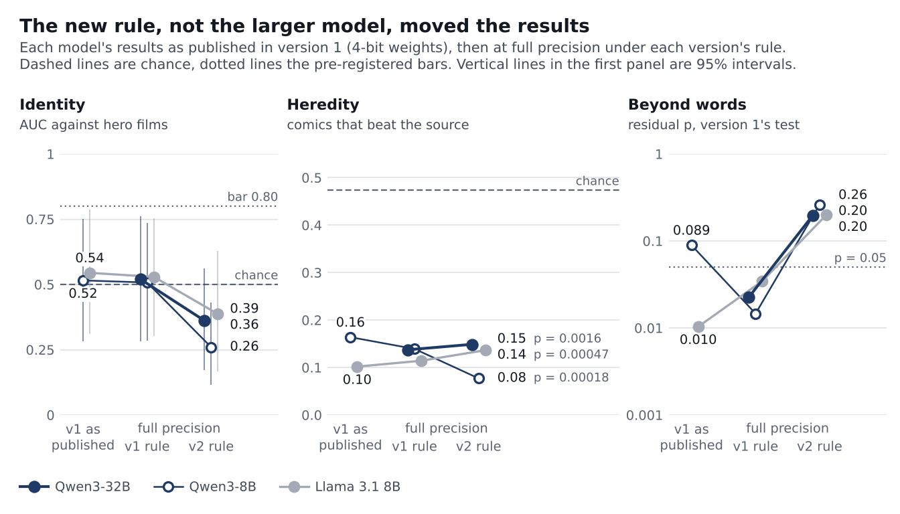
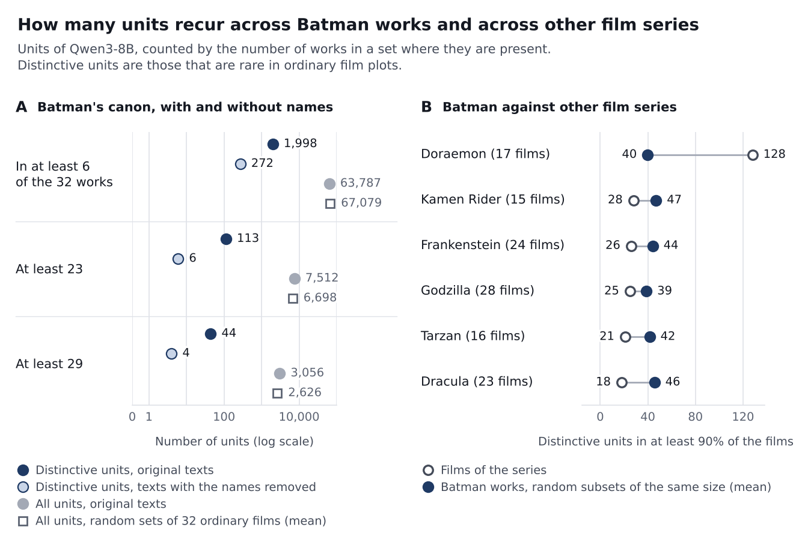
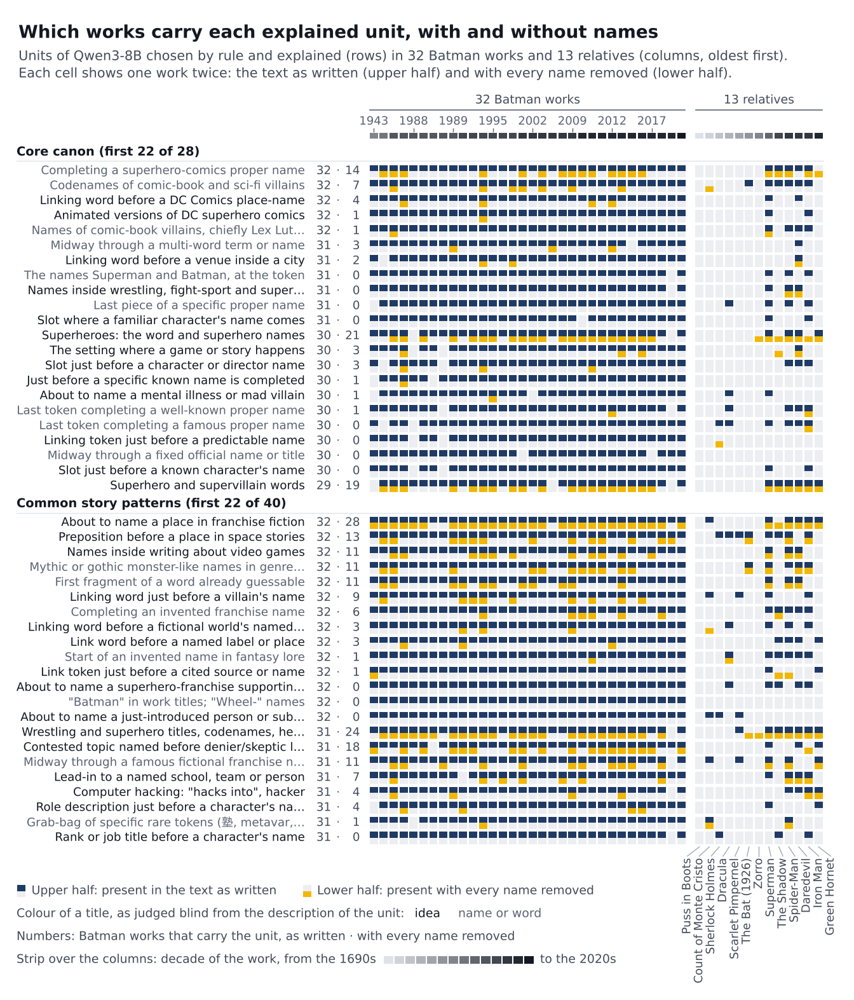
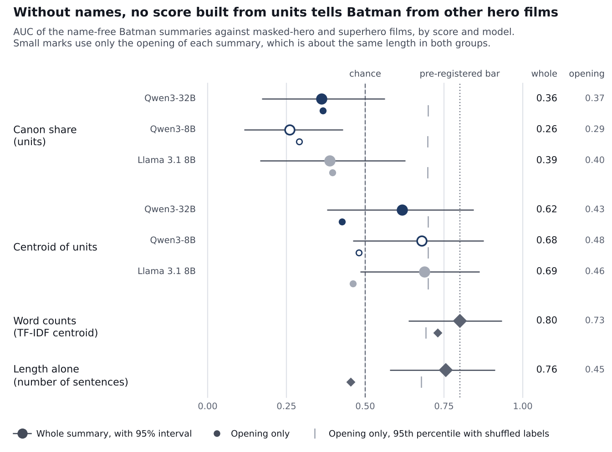
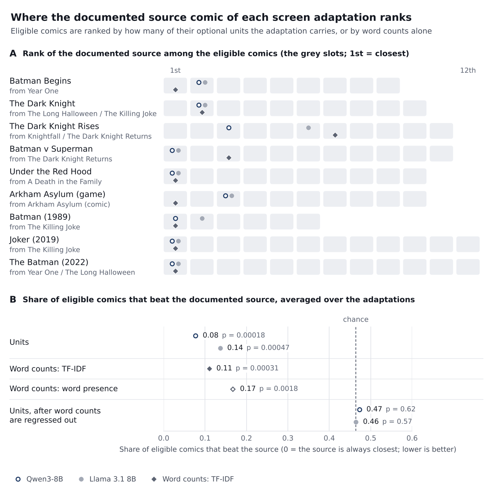
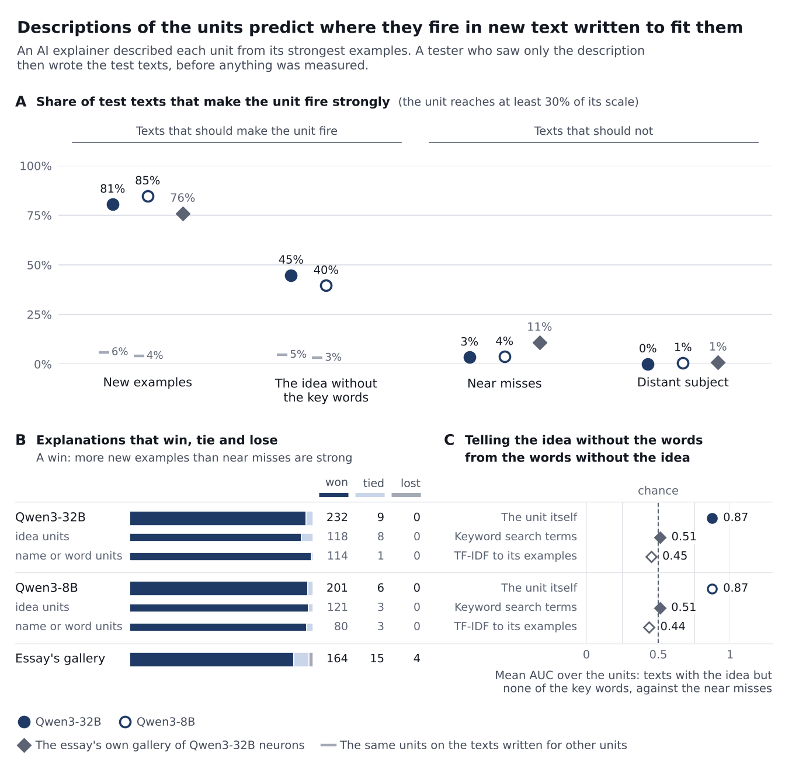
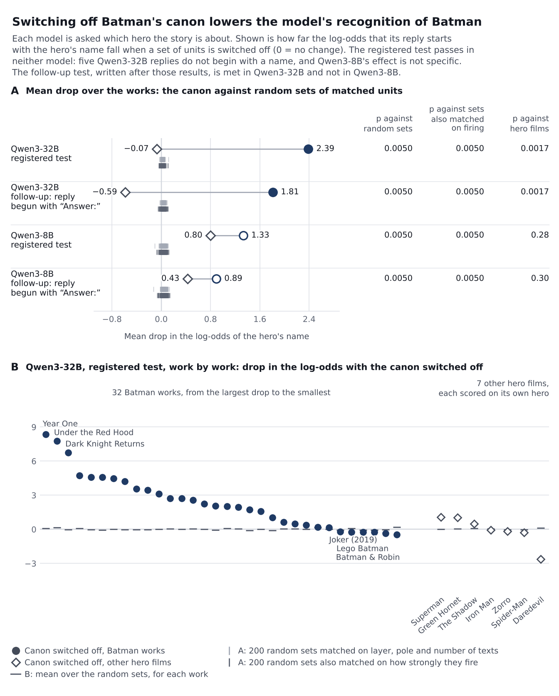

# Can Creativity Be Reverse-Engineered? Language-model neurons as units of cultural inheritance in 80 years of Batman

Mike Taylor and Claude (Anthropic) · Version 2, draft of 7 November 2026

*This is version 2 of the paper, in draft. Version 1 (20 October 2026) is unchanged in the repository. `CHANGES.md`, in the repository's `study/paper/v2/` folder, lists what changed and why.*

## Abstract

Memetics never had an agreed unit. A recent essay argues that most neurons in modern language models already have one main job [10]. That would make a neuron a ready-made unit: a meme is whatever makes a given neuron fire. Version 1 of this paper tested the idea on 32 Batman works from 1943 to 2022, with two small quantised models and a rule that counted any activation, however weak. This version repeats the study the way the essay studies neurons. The main model is Qwen3-32B at full precision. A unit is present in a work only where it fires strongly, at 30% or more of its strongest activation in about 48 million tokens of reference text. Explanations are written from the strongest examples and tested on new text, and steering and ablation are added. The plan was committed before the new models read a study text, and six tests were confirmatory.

One of the six passes. Heredity is supported: adaptations carry their documented source comic's units more than other comics' (15% of eligible comics beat the source, against 46% by chance; exact p = 0.0016), and the same holds in the three other models, in one of them with a failed positive control. Word counts find the sources at least as well (11%), and once word measures are regressed out the units add nothing (p = 0.69). Version 1's hint that Llama's neurons add something beyond words came from a test that words alone can pass, and is withdrawn. Identity fails more plainly than before. Without names, Batman's canon does not tell Batman from other hero films (AUC 0.36, at or below chance), and version 1's name-free "superhero core" of seven units is down to one, and to none in the model version 1 used. The largest model, Llama 3.3 70B, does better on identity (0.77, still short of the bar), and it is also the model that names the exact film for every ordinary plot it is shown, so it is recognising summaries it has read. Selection is not detected. Steering fails on the study's units (13% correct against 20% by chance), though the same procedure works on the essay's own neurons (23 of 40). Switching off Batman's canon, about 212 units out of 3.3 million, lowers the model's recognition of Batman far more than matched random units do (2.39 against 0.02 in log-odds). That test is not evaluable under a rule set beforehand, so it is not counted as a pass.

What improved is the unit itself. Descriptions of 241 units chosen by rule predict where they fire in newly written text about as well as the essay reports (81% of new examples and 3% of near misses), and 46% of the units still fire when their idea is expressed without its key words. By a blind judgment the canon they define is mostly names, places and words (38 of 60 core families), and much of the rest is the comic-book register. So a neuron can be named and the name can be tested, which version 1 could not claim. On this corpus that does not make it a better unit of inheritance than a word. Whether neurons see more than words has to be shown on stories whose wording has been changed on purpose. Those experiments are pre-registered and have not been run.

## 1. Introduction

Cultural evolution borrowed the gene's logic but never found its gene. Dawkins proposed the meme as the unit of cultural inheritance in 1976 [1], and the idea spread faster than any method for testing it. Two decades later the field's own stock-take asked whether memetics was a science at all [2]. The recurring answer was that no one could say where one meme ends and the next begins, so no one could count memes, track their copying, or measure their fitness [3]. Heylighen and Chielens review the field [17]. Cultural evolution research moved on without the unit, studying traits that could be coded by hand [4].

This study began with a recent claim from interpretability research. In "Neural networks are already clean", Cammarata argued that most neurons in modern language models such as Qwen3 already have one main job, often as specific as a feeling or a narrow trope, and that the apparent mess of earlier models came from fixable training and tooling problems rather than from superposition [10]. If that is right, a neuron is a ready-made, inspectable and testable unit, and memetics has the definition it lacked: a meme is whatever makes a given neuron fire. The rest of this introduction sets out why such a unit is needed, what it has to beat, and what the first version of this paper found.

The obstacles are specific. Concepts like "Batman" lack objectively measurable properties, and people hold different versions of them [16], so there is no agreed place to look for a "Batman meme" and no way to check that two people carry the same one. Members of a meme family such as the Scarlet Pimpernel, Zorro, Batman and Iron Man differ in more ways than they agree, so rule-based coding struggles to group them. Without a rigorous definition, memes cannot be categorised at scale, used for testable predictions, or measured without slow and error-prone human labelling. In that sense memetics is still pre-Mendel: no one has traced the inheritance of thousands of memes.

Hand-coded traits have carried that work a long way. Tehrani reconstructed the family tree of Little Red Riding Hood from coded plot features [5], and da Silva and Tehrani coded which international tale types each of 50 Indo-European populations tells, then used comparative phylogenetic methods to trace some tales to the Bronze Age [6]. The trait list in those studies comes from folklorists' indexes. It is reliable and expert, but it is fixed in advance, coarse, and costly to extend to a new body of stories.

Other work traces inheritance from the words themselves, with no hand-coded list. Barbrook and colleagues built a family tree of the manuscripts of *The Canterbury Tales* from their copying variants [21]. Chavalarias and Cointet rebuilt the branching lineages of scientific fields from the terms their papers share, and called the result phylomemetic [19]; this project uses the same word for a different method. Kuhn, Perc and Helbing found scientific memes, words and phrases that are inherited along citation links, with no linguistic knowledge [20]. In stories, film remakes can be matched from their Wikipedia plot summaries [22], and summaries of the same story become much harder to match once their names are replaced [23]. Word-based units like these are automatic too. So the question for any new unit is what it finds that words miss.

Language models offer a candidate unit that is neither fixed in advance nor hand-coded. Interpretability research has found single neurons that respond to one concept across many surface forms, including a Spider-Man neuron in CLIP that fires for photographs, drawings and the written name [7], much like the concept cells recorded in the human brain [18]. Neurons with similar jobs recur across separately trained models [8], and different models' representations appear to converge as they scale [9]. Text embeddings from different models can even be translated into one another without any paired examples, which suggests a shared geometry of meaning [27]. Automatic descriptions now exist for every MLP neuron of Llama 3.1 8B Instruct [24], one of the models used here, and features learned from text embeddings have been used to find and name the properties of texts that predict an outcome [25]. Cammarata's claim that most such neurons are already clean [10] is what would make them usable as a list of traits.

We test that proposal on one long, well-documented lineage: Batman, from the 1943 film serial to The Batman (2022), alongside literary and superhero relatives from Puss in Boots (1697) to The Green Hornet (2011). Batman is a convenient model organism. Its lineage is long and branching, many works state their sources, and fans and critics have argued for decades about what is and is not canon.

We ask three questions, matching the three things a science of memes needs. Identity: is there a set of neuron-defined memes that a story must carry to be Batman, and does it survive when every name is removed? Heredity: do adaptations carry the optional memes of their documented source comics more than those of other comics? Selection: do memes carried by popular early works spread further into later ones? Alongside these we ask whether the units respond to ideas or only to particular words, whether they find anything that plain word overlap does not, and whether the model uses them.

**What version 1 found.** The first version of this paper (20 October 2026) ran the study on Qwen3-8B and Llama 3.1 8B, with weights quantised to 4 bits, on a laptop. Adaptations carried their source comic's units more than other comics', so heredity was supported, but plain word overlap found the sources as well. Without names the canon could not tell Batman from other masked heroes. Most of the strongest units detected names and words, and selection was not detected.

That version's limitations section listed what its method left open. The models were smaller than the 32B model the essay studies, and quantised. A meme counted as present in a work whenever the work beat 68 of 69 ordinary films, so a weak activation counted as much as a strong one, where the essay's point is that the strong ones are what matter. The labels were read off the Batman corpus itself. Nothing was tested by steering or ablation.

**What this version changes.** This version re-runs the study the way the essay studies neurons. The main model is Qwen3-32B at full precision. Only a unit's own sign regime counts. A unit is present when it fires strongly: at least 30% of the strongest activation it reaches anywhere in a broad reference corpus. Explanations are written from the strongest examples in that corpus and then tested on new texts, where they can lose. Steering tests the labels, and ablation tests whether the model uses Batman's canon to know it is reading Batman. The corpus, the three experiments and their word-based comparators are those of version 1. Section 3.1 reports what the change of method did to each of version 1's conclusions.

## 2. Material and methods

The analysis plan for this version is `study/v2/PLAN.md` in the repository. It was committed and pushed before any of the new models read a study text. Thirty-one changes were made after that, each logged in Section 18 of the plan with its reason and with what was known at the time. Section 2.10 lists the ones that matter for reading the results.

### 2.1 Corpus

The corpus is unchanged from version 1. We used the plot sections of English Wikipedia articles, keeping the first 40 sentences of each. These retellings were written by people. The lineage comprises 32 Batman works from 1943 to 2022: 13 live-action films and serials, 12 comics, 4 animated films and 3 video games. The comparison set has 13 relatives. Five are literary ancestors: Puss in Boots, The Count of Monte Cristo, A Study in Scarlet, Dracula and The Scarlet Pimpernel. Eight are masked-hero or superhero films: The Bat (1926), The Mark of Zorro (1940), The Shadow, Superman, Spider-Man, Daredevil, Iron Man and The Green Hornet. There are also 69 popular films with no superheroes. In version 1 those films set the bar for every meme. Here they are 69 more ordinary stories. The corpus has 3,700 sentences.

The name-free version of every text is also unchanged: each proper name is replaced by a neutral code (X1, X2 and so on, consistent within a work). Two things about these texts are handled differently.

- **Codes.** The codes are our edit and not part of the story, and their numbers differ by work. In version 1 the bar for a name-free text came from name-free films, which have codes too. Here the bar comes from ordinary text without codes, so a unit that reacts to a code would look rare and specific. A code's own tokens are therefore not allowed to carry a unit's peak. Scores with the codes left in are kept as a check.
- **Length.** A unit's score is a peak over sentences, so a longer text has more chances, and Batman's summaries are longer than the hero films' (sentence count alone separates them with an AUC of 0.76). Every score is therefore also computed on each work's opening: its first sentences, at most 20 and at most 400 words, which leaves Batman works and hero films the same length (AUC 0.45).

### 2.2 Models and units

The main model is Qwen3-32B [11], the model the essay studies. Qwen3-8B is the same family at a quarter of the size, and is the model version 1 used. Llama 3.1 8B Instruct [12], from a different company, was version 1's replication model, and Llama 3.3 70B Instruct is that company's model at large scale. All four ran in PyTorch at the precision of their published weights (16-bit floating point) on rented GPUs. Version 1 ran the two 8B models with weights quantised to 4 bits.

A neuron is one channel of a feed-forward block: the product of a gate and a value, which feeds the block's output projection. Its positive and negative extremes are separate units, as in version 1 and in [10]. That gives 3,276,800 units in Qwen3-32B, 884,736 in Qwen3-8B, 917,504 in Llama 3.1 8B and 4,587,520 in Llama 3.3 70B. New in this version, an activation counts only where the gate is open. Where the gate is closed the product is a small echo of the opposite sign, which the essay shows to be a different signal from the unit's own. Each text was read as one continuous document, and the first position of a document is ignored.

To check the extraction, we compared our activations with the ones the essay publishes. For 63 Qwen3-32B neurons in layers 0 to 12 the essay gives 756 example contexts with the activation at a marked token. Ours correlate with the published values at r = 0.992.

### 2.3 Scale, presence and base rate

**Scale.** The essay calls a response strong when it reaches 30% of the neuron's strongest example in a large corpus. We measured each unit's strongest activation over a reference corpus of 46,000 documents (about 41 million tokens): 12,000 film plots, 24,000 English Wikipedia articles and 10,000 passages from books. English prose alone would understate the maximum of a unit whose real job is code, chat or another language, so a supplement of 5,434 documents (about 7 million tokens) adds source code, conversations with an assistant, Wikipedia in ten other languages, news and reviews. A unit's scale is its strongest activation in the reference corpus, the supplement or the study's own original texts.

**Presence.** A unit is present in a work when its strongest activation in any sentence of the work is at least 30% of its scale. Version 1 asked instead whether the work beat 68 of 69 reference films, so any activation counted, however weak.

**Base rate.** Three thousand of the film plots, cut to 40 sentences like the study's works, serve as the background of ordinary stories. A unit's base rate is the share of them in which it is present. One turned out to be a study film under an older title and was left out, which leaves 2,999. A unit is distinctive when its base rate is at most 3%, the rate at which an ordinary film crossed version 1's bar.

**Which units enter which analysis.** The canon, the identity experiment and most of the units chosen for explanation use distinctive units, because there the question is what marks Batman off from ordinary stories. The heredity and selection experiments use every unit, as version 1 did. There the question is which units two works share, and the word-based comparators drop no word either.

### 2.4 Memes, canon and other franchises

Candidate memes are distinctive units present in at least 6 of the 32 Batman works. Candidates that fire strongly on the same sentences (correlation of at least 0.5, average linkage) were merged into meme families, as in version 1. Canon tiers follow the number of Batman works a meme appears in: core (29 or more), common (23 to 28) and optional (6 to 22).

Version 1 compared Batman's canon with random sets of the 69 films. Under a 3% cap a random set of ordinary films cannot have a canon, whatever Batman is like. So this version adds comparisons that could fail: random sets of 32 background plots of one genre, and six other film series from the same plot dataset in which one character's name is in the title of at least 15 films (Godzilla, Frankenstein, Dracula, Doraemon, Tarzan and Kamen Rider).

### 2.5 Three pre-registered experiments

The designs, statistics and nulls are version 1's. E2, E3, the sequel control and the residual test are computed by version 1's own code on the new presence data. These are the same 32 works, analysed a second time by a method fixed in advance, with version 1's outcome known. Agreement between the two versions is therefore not independent confirmation.

**E1, identity.** For each Batman work, canon units are distinctive units present in at least 80% of the other 31 works (original texts). The held-out work is scored by the share of canon units present in its name-free text, and compared with the 8 masked-hero and superhero films. The prediction is met if the AUC is at least 0.80, its bootstrap 95% lower bound is at least 0.65, it is above the 95th percentile of a label-shuffle null, it holds within 0.05 after dropping sentences with iconography words, and, on the openings, it is at least 0.70 and above its own label-shuffle null. The last clause is new: without it a pass could be a matter of length. It is falsified, as version 1 registered, if the AUC is below 0.70 or its interval includes 0.5.

Version 1 put its failure on E1 down to the scoring rule, because a word-based centroid score reached 0.80 where the canon share reached 0.52. So the units are also given the words' rule: the cosine between a work's vector of strong unit activations, each weighted by the unit's rarity in the background plots, and the centroid of the other 31 works. The same criteria are applied to that score, to the TF-IDF centroid and to length alone.

**E2, heredity.** Nine adaptations have a documented source comic among the 12 comics. Optional units are those present in 2 to 16 of the 32 Batman works (name-free texts). For adaptation A and comic C, the inheritance rate is the share of C's optional units also present in A, z-scored against the same rate in the 11 Batman screen works that adapt no comic. The statistic is the share of eligible comics that beat the documented source, averaged over the adaptations. It is tested exactly, over all 3,991,680 ways of relabelling the comics. The prediction is an exact p below 0.05. The positive control is that at least 5 of 7 sequels rank their prequel among the top two earlier screen works. The word comparators (TF-IDF cosine and word presence on the same name-free texts) go through the same test.

**Beyond words: the residual test.** Whether the neurons add anything beyond shared words is decided by one test: the neuron inheritance rate with word measures regressed out, tested the same way. Version 1 regressed out two word measures. Before any Qwen3-32B result existed, two reviewers showed with words alone that this form can pass with nothing beyond words in it: a third word measure that leans towards commoner words, or counts repeats, passes it in the neurons' place (p = 0.002 and 0.0002). The decision test therefore regresses out seven word measures: version 1's two, word presence in four bands of frequency, and TF-IDF on raw counts. Fifteen further word-only measures were then put through it in the neurons' place. None passes (lowest p = 0.12), where seven of the fifteen pass version 1's form. "The neurons add something beyond shared words" is claimed only if the decision test passes at the primary setting and in at least half of eight sensitivity settings, and a version with every word and code measure regressed out passes too. Version 1's two-measure form is reported beside it.

**E3, selection.** Unchanged: across the 15 Batman works before 2000, the rank correlation between log pageviews and the spread of a work's units into the 9 later works that adapt no comic. With 15 works the test has about 27% power against a true correlation of 0.3, so this version makes no claim about selection whatever the result.

**Recognition.** A 32B model has read these Wikipedia summaries. Given a name-free one it may simply work out which story it is. So each model was asked, for each name-free text, which famous fictional hero the story is about and which work it summarises, and the experiments are read against its answers.

### 2.6 Explaining units, and letting the explanations lose

Version 1 named its memes from eight sentences of the Batman corpus itself. Here the units to explain were chosen by rule, before anyone read an example, in eight sets:

- *core*: the representative of every core-canon family, up to 60;
- *common* and *optional*: 30 families drawn at random from each of those tiers;
- *name-free core*: canon units still present in at least 70% of the name-free Batman works, up to 40;
- *discriminators*: the 40 distinctive units that best separate name-free Batman works from the hero films;
- *common story patterns*: the 40 units with a base rate between 3% and 30% that are most over-represented in Batman works, which the 3% cap would otherwise hide;
- *inherited* and *not inherited*: 20 units drawn at random from E2's optional units that an adaptation shares with its source, and 20 from the rest.

The same rule was applied to Qwen3-8B. Each role below was played by AI agents (Claude) that saw nothing but their own prompt. The prompts are in `study/v2/prompts/`.

- An *explainer* read each unit's 16 strongest examples from the reference corpus and supplement, the first six with their whole document up to the peak, its 8 strongest study sentences, and the strongest examples of its opposite pole. It wrote a title, a short explanation and at least 8 key words. It ran no experiments.
- A *tester* saw only the title, explanation and key words. Before anything was measured it wrote five new texts that should make the unit fire (A), five that should make it fire while using none of the key words (B), five near misses that should not fire, at least three of which reuse a key word in another sense (C), five on a distant subject (D), and one meant to fire it as hard as possible.
- A *keyword analyst* saw only the title and explanation and wrote the search terms of someone who expects the wording to be evaded.
- A *kind judge* saw only the title and explanation. It said what kind of thing the unit detects, and whether it reacts to a particular name or word or to an idea that can be put in other words.

A text's response is the unit's strongest activation in it as a share of its scale, and 30% or more is strong, as in the essay. An explanation *wins* when more of its A texts than of its C texts are strong. A unit is *idea-bound* when at least 3 of its 5 keyword-free texts are strong and at most one keyword-reusing near miss is. Every text was scored on every explained unit, which gives the rate at which a unit fires strongly on texts written for other units. Two word-based measures were scored on the same texts: the analyst's search terms, and TF-IDF similarity to the unit's examples.

Test texts are short and read alone, while a unit's scale comes from documents of about 1,000 tokens. A unit whose own strongest study sentence and strongest reference examples all stay below 30% when read alone is counted apart, as *not testable out of context*. A coverage check asked a blind judge whether each description predicts the unit's firings at 30 to 60% of scale, where presence is decided, on passages from the background plots.

This is label validation. It is not the planted-story test that the pre-registration reserves for the question of whether neurons follow an idea when the words change (Section 4.5).

### 2.7 Steering and ablation

Neither test was in version 1. Both were specified in the plan before being run.

**Steering.** The model continued three neutral story openers for 40 tokens with one unit's activation held at a multiple of its scale, and once without. A blind judge who saw both sets of continuations picked which of five unit titles had been pushed in, or "none of these". The multiple was chosen beforehand on 40 neurons from the essay's public gallery, not on study units. The criterion is accuracy on the units whose kind is an idea, against 20% chance.

**Ablation.** Each model was asked which hero each name-free Batman summary is about. The outcome is the log-odds that its reply starts with Batman's name, with nothing touched and with that work's canon units switched off on the tokens of the summary only. The canon's effect is compared with two controls of 200 random sets each. In the first, every canon unit is replaced by a unit of the same layer and pole that is present in about as many name-free Batman works. In the second, the replacement is also matched on how strongly it fires in these texts, so that the sets remove about as much activation as the canon does. The criterion needs p below 0.05 against both controls, and a larger effect on the Batman works than on seven hero films scored on their own hero's name. Because the score is the probability of the reply's first word, the test counts only if the untouched model's reply begins with a name for at least 28 of the 32 Batman works.

### 2.8 Two models

For each explained Qwen3-32B unit, its twin in another model is the unit there whose activations across the 3,700 original-text sentences correlate most strongly with it. Version 1 scored twins on those same sentences. Here they are scored where they were not chosen: on the tester's texts written for the Qwen3-32B unit, and on the name-free sentences, against control units matched on how well a single word predicts them.

### 2.9 What is confirmatory, and robustness

Six tests are confirmatory, all for Qwen3-32B under the new rule: E1, E2, the residual test, E3, the ablation and steering on idea units. Each is read at 0.05, with Holm-adjusted p values beside them. The other three models are replications. Everything else is description or a sensitivity check.

The sensitivity checks were fixed in advance. They vary the threshold (20, 30, 40 and 50% of scale), the score (strongest sentence or the mean of the three strongest), the base-rate cap (1% to 30%, or none), the scale (without the study texts; the fifth-strongest example in place of the strongest), text length (openings), the handling of the codes, the echo regime, weak poles and units whose scale comes from the supplement. To separate the effect of the new rule from the effect of the new models, every primary statistic was also computed under version 1's rule on the new activations.

### 2.10 Changes after the plan was frozen

The plan logs thirty-one. Most were made before the result they bear on existed. These are the ones that change how a result is read.

- The residual test regresses out seven word measures, not two (Section 2.5). Its sensitivity rule uses the eight settings with no base-rate cap, because a cap applied to units and not to words can make the test pass or fail for reasons unrelated to the question.
- The ablation has a second control matched on activation removed. It is scored in log-odds, because a fall in log-probability shrinks as the model grows confident. It counts only if the untouched replies begin with a name (Section 2.7).
- Genre sets take their base rates from plots of other genres.
- A whole-work E1 score is always quoted with its opening-only score and with length alone.
- A count of model-by-rule cells below 0.05 is reported against a joint null, because the cells share the same 32 works. This was decided after the two 8B models' results were in and before any Qwen3-32B result.

Besides that one, three changes were made after a result had been seen, and none changes the outcome of a test. The coverage judging was repeated, because the item ids in the first round told the judge the answer. The first round's tally had been seen (54.5% of firing passages covered, 2.9% of silent ones wrongly claimed), and the blind round gives 48% and 3%. The rule that decides whether a reply begins with a name treated "The Joker" as a sentence. It was corrected after Qwen3-8B's ablation had been scored, and the outcome is the same for both models under either form of the rule. A count of the placeholder codes in the name-free texts (Section 3.7) was added after the explanations had been read, as a description.

One planned step, the re-scoring of version 1's rewordings (Section 3.7), had been missed. It was run last, after the fact-check of this paper found the gap. Two things in the plan were not done. Two of the second-opinion checks in the review of the plan were cut short when the analysis machine restarted. For Llama 3.3 70B the sensitivity grid, the multiverse and version 1's rule were not run, for lack of time and of disk space on the analysis machine. Its results are for the primary setting only. The explanation tests and the ablation were run on the two Qwen models, and steering on Qwen3-32B alone.

## 3. Results

### 3.1 The six confirmatory tests, and what became of version 1's conclusions

One of the six confirmatory tests passes (Table 1).

| Test | What was predicted | Qwen3-32B | Outcome |
| --- | --- | --- | --- |
| E1, identity | Without names, the share of Batman's canon a work carries separates Batman from other hero films (AUC at least 0.80) | AUC 0.36 (95% interval 0.17 to 0.56); 0.37 on openings | Falsified |
| E2, heredity | Adaptations carry their documented source comic's units more than other comics' | 15% of comics beat the source, against 46% by chance; exact p = 0.0016 | Supported |
| Residual test | The units still find the source once word measures are regressed out | p = 0.69; 0.86 with every measure regressed out | Not supported |
| E3, selection | Units of popular early works spread further | rho = 0.35, p = 0.37 | Not detected |
| Ablation | Switching off the canon lowers the model's recognition of Batman more than matched random units, and more than it lowers other heroes' | Fall of 2.39 in log-odds against 0.02; p = 0.005, 0.005 and 0.0017 | Not evaluable under the rule set beforehand |
| Steering | A blind judge can tell which idea unit was pushed (chance 20%) | 17 of 126 (13%), p = 0.98 | Not met |

**Table 1.** The six confirmatory tests, all on Qwen3-32B under the new rule. With Holm's adjustment over the five tests that have a p value, E2's is 0.008 and the ablation's 0.020.

Read against version 1, the conclusions are these.

1. **Heredity stands.** It is supported in Qwen3-32B and in each of the other three models, in Llama 3.1 8B with a failed positive control (Sections 3.4 and 3.10).
2. **Words still find the sources as well as neurons do.** The larger model, the full-precision weights and the stricter rule do not change that, and no model adds anything to the words (Section 3.4).
3. **The hint that Llama's neurons add something beyond words is withdrawn.** The test behind it can be passed by words alone. Under a test that none of the word-only measures we tried passes, no model passes under either rule (Sections 2.5 and 3.10).
4. **Identity fails, and more plainly.** The canon share falls from 0.52 to 0.36. Version 1 blamed the scoring rule. Given the words' scoring rule, the units reach 0.62, which is no better than the length of the text. The one exception is Llama 3.3 70B at 0.77, which is still short of the bar, in a model that recognises nearly every summary it is shown (Section 3.3).
5. **The name-free core has gone.** Version 1 found seven name-free units in Qwen3-8B (nine in Llama 3.1 8B) that read like the definition of a superhero. Under a rule that counts only strong activations, Qwen3-8B has none and Qwen3-32B one (Section 3.2).
6. **The canon is mostly names, now by a blind judgment.** 38 of 60 core families detect a name, place or word (Section 3.7).
7. **Selection is still not detected,** in a test that could not have detected much (Section 3.5).

Three things are new.

8. **The units can be described, and the descriptions can be tested.** Descriptions written from a unit's strongest examples predict its firing on new text at about the rate the essay reports, and 46% of units still fire when their idea is put in other words (Section 3.7).
9. **The model's recognition of Batman runs through the canon units,** in numbers that the registered test does not let us count as a pass (Section 3.8).
10. **Pushing a unit does not produce its description,** although the same procedure works on the essay's own neurons (Section 3.8).

Figure 1 separates the effect of the new rule from that of the new models. Under version 1's rule the models at full precision, Qwen3-32B included, give version 1's E1 and E2 numbers again, and version 1's form of the residual test passes in all three (in Qwen3-8B it was 0.089 as published and is 0.015 at full precision). Under the new rule E1 falls and that test fails in all three. So, up to 32B, it was the rule, and not the size of the model, that moved E1 and took the residual test from passing to failing (Section 3.10).

**Figure 1.** What changed between versions. Identity (E1), heredity (E2) and version 1's form of the residual test for each model: as published in version 1, at full precision under version 1's rule, and under the new rule.

### 3.2 Presence, the canon, and other film series

**Presence.** Of Qwen3-32B's 3,276,800 units, 1,812,516 fire strongly in at least one of the 114 works, and 885,060 of those are distinctive, meaning present in at most 3% of ordinary film plots. A typical Batman summary has 140,954 units present with its names and 102,256 without (medians). A third of all units (1,035,162) reach their strongest activation in the supplement of code, chat, other languages, news and reviews, which is what the supplement was added for. Only 4,518 take their scale from the study's own texts. For 82,189 positive poles, 5.0% of neurons, the strongest raw activation is an echo of the other sign regime. The essay puts that figure at about 4%, and under version 1's rule those echoes counted as the unit's own.

**The canon.** 7,520 distinctive units are present in at least 6 of the 32 Batman works. Merging those that fire strongly on the same sentences gives 4,996 meme families: 74 in the core (29 or more works), 135 common and 4,787 optional. Counted as units, 334 are in at least 23 works and 120 in at least 29 (Figure 2A). The two 8B models have fewer (44 and 59 units in at least 29 works) and Llama 3.3 70B about as many (114).

Remove the names and most of the canon goes with them. On the name-free texts 48 distinctive units are in at least 23 works and 12 in at least 29. E1's canon, the distinctive units present in at least 80% of the works, has 204 units, and exactly one of them is still present in 70% of the name-free works. Qwen3-8B has none, Llama 3.1 8B one and Llama 3.3 70B ten. Version 1 reported a name-free core of 7 units in Qwen3-8B (9 in Llama 3.1 8B) and read it as "close to the standard definition of a superhero" [26]. Under a rule that counts only strong activations, even that has all but gone. Section 3.7 says what the one surviving unit is.

**Is that more of a canon than other bodies of films have?** Three comparisons could have failed.

- *Random sets of 32 ordinary films.* With the 3% cap a random set cannot have a canon, by construction. Without the cap, Batman has 5,765 units in at least 29 works against a mean of 4,033 for 50 random sets, and the largest of the 50 has 4,492. So Batman's summaries share more units than random films do, but about 70% of what 32 Batman summaries share is what any 32 plot summaries share.
- *Genre sets.* When 32 plots of one genre stand in for the franchise, with base rates taken from the other genres, no drama, comedy, thriller or action set has a single distinctive unit in 23 of its 32 plots, and horror sets average 0.28. Batman has 334. A genre is not a canon by this measure.
- *Other film series.* Batman has more distinctive units in at least 90% of its works than four of the six series have in theirs, about as many as Kamen Rider, and a third as many as Doraemon (Table 2, Figure 2B). At the 72% bar Kamen Rider is ahead of Batman too.

| Series | Films | Units in 90% or more of the films | Batman works, random subsets of the same size (mean) |
| --- | --- | --- | --- |
| Godzilla | 28 | 89 | 102 |
| Frankenstein | 24 | 39 | 116 |
| Dracula | 23 | 38 | 119 |
| Doraemon | 17 | 327 | 108 |
| Tarzan | 16 | 50 | 114 |
| Kamen Rider | 15 | 119 | 128 |

**Table 2.** Batman against six other film series from the same plot dataset, Qwen3-32B, original texts: distinctive units present in at least 90% of a series' films.

So Batman does have a canon in this sense, and so do other series. What the count measures is how uniform a series' summaries are, in names and stock phrases as much as in story. A series with a fixed cast and a formula, as Doraemon has, scores highest. In all four models Doraemon is far ahead of the other series and Kamen Rider comes second.

**Figure 2.** The canon under the new rule, Qwen3-32B. (A) Units present in at least 6, 23 and 29 of the 32 Batman works: distinctive units on the original texts and on the name-free texts, and all units with no base-rate cap beside the mean for random sets of 32 ordinary films. (B) Distinctive units present in at least 90% of each film series' films, against Batman works in random subsets of the same size.

**Figure 3.** Which works carry which units. Rows are units chosen by rule and explained (Section 3.7), with the explainer's title. Columns are the 32 Batman works and then the 13 relatives, each in date order. The upper half of a cell is filled where the unit is present in the text as written, the lower half where it is present with every name removed. Titles in black were judged, blind, to describe an idea; titles in grey a particular name or word.

### 3.3 E1: identity

**Without names, Batman's canon does not tell Batman from other masked heroes.** For Qwen3-32B the canon share has an AUC of 0.36 against the eight hero films, with a 95% interval of 0.17 to 0.56 (Figure 4). The prediction needed 0.80, so by the criteria registered for version 1 it is falsified, as it is in Qwen3-8B (0.26) and Llama 3.1 8B (0.39). Llama 3.3 70B is different, and is taken up below. The score is at or below chance, which means the hero films carry more of Batman's canon than the name-free Batman works do. Superman, Spider-Man, Daredevil and Iron Man each carry more of it than at least 79% of the Batman works. The result is not a matter of length: on openings of equal length the AUC is 0.37.

The reason is visible in the units. With names present the canon share separates Batman from everything at an AUC of 1.00. Nearly all of those units respond to Batman's names and places, and the name-free texts delete them. What is left fires on superheroes in general, and the summaries of superhero films use that vocabulary more than Batman's own do. Against ordinary films and the literary relatives the name-free canon share still separates Batman (AUC 0.96 and 0.98), as in version 1. It tells a superhero story from other stories. It does not tell Batman from Superman.

**It was not the scoring rule.** Version 1 put this failure down to its scoring rule, because a word-based centroid score reached 0.80. Given the same rule, the units do no better: the centroid of unit activations has an AUC of 0.62, and on the openings 0.43. Its whole-summary value is no better than text length alone, which reaches 0.76 on whole summaries and 0.45 on openings. The word-based centroid stays ahead at 0.80, and it is the only score that also holds on the openings (0.73, above its own shuffled-label null). It still does not meet the full prediction, because the lower end of its interval is 0.64 against a required 0.65. A canon chosen on the name-free texts themselves, a control from version 1, reaches 0.60.

**The model itself does better than its canon.** Asked which hero a name-free summary is about, Qwen3-32B answers Batman for 21 of the 32 Batman works, and also for 4 of the 8 hero films (Table 3). The log-probability it gives to Batman's name separates Batman works from hero films with an AUC of 0.78, about as well as word counts and far better than the canon share. The two are related: across the 32 works the canon share and that log-probability correlate at rho = 0.63. So the canon units do track the model's recognition of Batman. But the recognition draws on more than the units that count as present.

**The largest model is the exception, and it is the one that knows the plots.** Llama 3.3 70B's canon share reaches 0.77 (95% interval 0.60 to 0.91), and 0.65 on openings. That misses the bar, the interval and the openings criterion, so the prediction is not met. It is not falsified either, and ten of this model's 215 canon units survive in the name-free works. This is also the model that says a name-free summary is about Batman for 29 of the 32 works and names the exact film for all 69 ordinary plots (Table 3). For the 29 works it names, the canon share separates them from the hero films at 0.81. For the three it does not name, the figure is 0.33. So in this model the canon units fire on a name-free text when the model has worked out whose story it is. That is recognition of summaries it has read. It is not a name-free essence, and the registered test cannot tell the two apart.

**Figure 4.** Telling name-free Batman summaries from the eight masked-hero and superhero films, by each model's units, by word counts and by length alone. Large marks are whole summaries with 95% bootstrap intervals; small marks use only the opening of each summary, which is the same length in both groups. The pre-registered bar is 0.80.

### 3.4 E2: heredity, and whether neurons add anything to words

**Adaptations carry their source comic's units.** In Qwen3-32B, on name-free texts, 15% of eligible comics beat the documented source, against 46% expected by chance (exact p = 0.0016; p = 0.0083 when comics are relabelled only within their era). The documented source is the closest eligible comic for four of the nine adaptations and second for two more (Figure 5). The real value is below every placebo target, and 5 of 7 sequels rank their prequel in the top two, so the positive control passes. Heredity is supported, as it was in version 1. Qwen3-8B gives 8% (p = 0.00018), Llama 3.1 8B 14% (p = 0.00047) and Llama 3.3 70B 6% (p = 0.00011). Llama 3.1 8B fails the sequel control (4 of 7), so its result is supported with a failed positive control.

**Word counts find the sources at least as well.** TF-IDF cosine on the same name-free texts gives 11% (p = 0.00031) and ranks the source first for six of the nine adaptations. Word presence gives 17% (p = 0.0018). Qwen3-32B does not pull ahead of words: its 15% is behind TF-IDF's 11%. Llama 3.3 70B has the best figure of any measure at 6%, and its residual test fails like the others.

**The neurons add nothing that these word measures do not have.** With the seven word measures regressed out of the neuron inheritance rate, 49% of comics beat the source, which is chance (decision test, exact p = 0.69). With every word and code measure regressed out, p = 0.86. In version 1's two-measure form p = 0.20. The other three models agree (decision test p = 0.62, 0.57 and 0.20). The reverse is not true: with the neurons regressed out of TF-IDF cosine, the words still find the sources (11%, p = 0.0004). On this corpus the words carry the trail and the neurons carry part of it.

Version 1 reported that this test passed for Llama 3.1 8B (p = 0.010 to 0.033) and read it as a hint that Llama's neurons add a little beyond words. That reading does not survive. The form of the test used there passes for word-only measures in the neurons' place (Section 2.5). Put through the decision test, no model passes under either rule (Section 3.10).

**Figure 5.** Heredity on name-free texts. (A) For each adaptation, the rank of its documented source among the eligible comics, by each model's units and by TF-IDF word counts. (B) The share of eligible comics that beat the documented source, averaged over the nine adaptations, for units, for the two word measures, and for units after the word measures are regressed out.

### 3.5 E3: selection

Selection was not detected, as in version 1. In Qwen3-32B the correlation between an early work's popularity and the spread of its units into later works is rho = 0.35 (one-sided p = 0.37). Qwen3-8B gives 0.35 (p = 0.37), Llama 3.1 8B 0.17 (p = 0.56) and Llama 3.3 70B −0.17 (p = 0.83). With 15 early works the test would detect a true correlation of 0.3 about a quarter of the time, so this says little either way.

### 3.6 Does the model simply recognise the plots?

These models have read Wikipedia, and it shows (Table 3). Given a name-free summary, Qwen3-32B names the exact work for 52 of the 69 ordinary films and 5 of the 8 hero films. It does so for only 4 of the 32 Batman works: it knows it is reading Batman, but not which Batman. Llama 3.3 70B names the exact work for every one of the 69 ordinary films and for 15 of the Batman works.

| | Qwen3-32B | Qwen3-8B | Llama 3.1 8B | Llama 3.3 70B |
| --- | --- | --- | --- | --- |
| Batman works it says are about Batman | 21 of 32 | 20 of 32 | 16 of 32 | 29 of 32 |
| Batman works it identifies by title | 4 of 32 | 2 of 32 | 2 of 32 | 15 of 32 |
| Hero films it says are about Batman | 4 of 8 | 4 of 8 | 1 of 8 | 1 of 8 |
| Hero films whose own hero it names | 4 of 7 | 3 of 7 | 5 of 7 | 7 of 7 |
| Ordinary films it identifies by title | 52 of 69 | 36 of 69 | 54 of 69 | 69 of 69 |
| AUC of its log-probability of "Batman", Batman works against hero films | 0.78 | 0.57 | 0.76 | 0.90 |

**Table 3.** What each untouched model says about a name-free summary.

This matters for how the experiments are read. Had E1 passed, the paper would have had to say that the model recognises Batman's plots, which is a different thing from a name-free essence. In the three models up to 32B it failed, so the question does not arise. In Llama 3.3 70B it nearly passes, and Section 3.3 reads it that way. For E2 the worry runs the other way: could memorised plots carry the source trail? Qwen3-32B identifies both the adaptation and one of its sources for only one of the nine pairs (The Dark Knight Rises), and that pair is the one where the units place the source worst. Llama 3.3 70B identifies both for five of the nine, and its units place the source no better for those five than for the other four (7% and 6% of comics beat the source). So recall of specific works does not explain the heredity result.

### 3.7 What the units are, and whether their descriptions hold up

The rule of Section 2.6 chose 241 units in Qwen3-32B and 207 in Qwen3-8B, which has fewer core families. Each got a title and an explanation from an explainer that read its strongest examples, and each explanation was then tested on texts written by someone who had seen nothing else. No unit had to be set aside as not testable out of context.

**The descriptions predict new text about as well as the essay's do.** In Qwen3-32B, 81% of the texts that a tester wrote to fire a unit did fire it strongly, against 3% of the near misses and 0.1% of the texts on a distant subject (Table 4, Figure 6). The essay reports 76%, 11% and 1% for its own gallery. By the essay's scoring, 232 explanations won, 9 tied and none lost. The floor matters here, because a tester writes on the unit's subject and many units share subjects: on texts written for *other* units, a unit fires strongly 6% of the time and an explanation "wins" 17% of the time. So a win is weak evidence on its own, and the rates are the result to read.

| | New examples (A) | Idea without the key words (B) | Near misses (C) | Distant (D) | Won / tied / lost | Idea-bound |
| --- | --- | --- | --- | --- | --- | --- |
| Qwen3-32B, 241 units | 81% | 45% | 3% | 0.1% | 232 / 9 / 0 | 110 (46%) |
| of which idea units, 126 | 74% | 51% | 2% | 0.2% | 118 / 8 / 0 | 72 (57%) |
| of which name or word units, 115 | 88% | 38% | 5% | 0% | 114 / 1 / 0 | 38 (33%) |
| On texts written for other units | 6% | 5% | | | wins 17% | 2.4% |
| Qwen3-8B, 207 units | 85% | 40% | 4% | 0.7% | 201 / 6 / 0 | 73 (35%) |
| The essay's gallery [10] | 76% | | 11% | 1% | 164 / 15 / 4 | |

**Table 4.** The explanation tests: the share of each kind of test text on which the unit fires strongly (at least 30% of its scale). A unit is idea-bound when at least 3 of its 5 keyword-free texts fire strongly and at most one keyword-reusing near miss does.

**About half the units follow their idea when its key words are taken away.** Texts that express a unit's idea while using none of its key words fire it strongly 45% of the time, and 110 of the 241 units (46%) are idea-bound, against a floor of 2.4%. On the same texts the unit separates the keyword-free texts from the near misses with a mean AUC of 0.87. The keyword analyst's search terms manage 0.51 and TF-IDF similarity to the unit's examples 0.45. The word measures are at chance by construction, since the texts were written to defeat key words, so this is not a contest that words could have won. What it shows is that these units are not keyword detectors: a description of what a unit responds to predicts its firing on text that shares no key word with the description. That is the essay's claim, and it holds on the units this study uses. It is a claim about units on short test texts. It does not show that units find a story's source better than words do, and Section 3.4 shows that on this corpus they do not.

**Batman's canon is mostly names and the comic-book register.** A blind judge who saw only the descriptions put 38 of the 60 core-canon families down as detecting a particular name, place or word (63%, 95% interval 52% to 75%). Version 1 reached the same view by hand, with 27 of 33. The titles make the point: "The name 'Gotham' in any sense", "'Dent' in Harvey Dent; Batman villain names", "The Joker and clownish comic figures", "Costumed-superhero name stems, especially Bat- and Wayne". Most of the rest are of two kinds. Some respond to superhero-comics writing as a genre ("Superhero conventions: first appearance, costume, powers"; "DC Comics titles, teams and issue numbers"). Others sit on the linking word just before a name and fire when the model expects a comic-book character to be named next ("Linking word just before a villain is named"). None of the 60 was judged to be a story pattern, something that happens in a story.

**The one unit of the name-free core** is L38·N18216−, titled "Superhero comics: heroes versus costumed villains". It is present in 24 of the 32 name-free Batman works, and it passed every test, including all five keyword-free texts. It is a genre unit. It is also present in 5 of the 8 name-free hero films, which is E1's failure in one unit.

**What separates name-free Batman from other heroes is mostly our own editing.** The 40 distinctive units that best tell name-free Batman works from the hero films should have been where Batman's essence showed. Their titles are "Token right after a digit", "Unexpected token straight after a number or code", "Just after a name missing from the text", "Text with a missing word or glitch". They respond to the placeholder codes and the gaps they leave. The typical one is present in 1 of the 32 Batman works as written and in 13 or 14 once the names are replaced, and it is also present in 15 of the 69 name-free ordinary films. They are the hardest set to describe as well: 57% of their new examples fire, against 97% for the core, and 8 of the 9 ties are here. One of the 40 is about the story: "Toxins, poisons and toxic substances".

Batman's summaries simply have more names to replace. A name-free Batman text holds a median of 105.5 placeholder codes and a hero film 70.5, and the count of codes alone tells the two groups apart with an AUC of 0.88, which is higher than any unit or word score in Figure 4. Code tokens are masked (Section 2.1), but the words around a code still show that something was cut. A unit that marks a text as edited is not a meme. This is a limit of the name-free method itself, in version 1 as much as here, and it means that a pass on E1 would have needed checking against it.

**Story ideas appear once the 3% cap is lifted.** The 40 commoner units most over-represented in Batman works include "Character taking on a named alter ego", "The word 'vigilante': crime-fighting outside the law", "Villain and hero as stock story roles" and, among the common-tier families, "Superhero's double identity: civilian linked to hero persona". These are the superhero ideas version 1 found in its name-free core, and they are real units whose descriptions pass the tests. The first three are in more than 3% of ordinary film plots, so they are not distinctive. All four also turn up in the hero films, so none picks out Batman.

**The units that carry the source trail are ordinary ones.** The 20 units drawn from those an adaptation shares with its source comic are grammar and everyday story content: "Pointing back to something just mentioned", "Victim noun right after a violent verb", "Going into a river, lake or floodwater", "Two people acting or bonding as a pair". The 20 drawn from the rest look the same. This fits Section 3.10: heredity is carried by ordinary story material, which words carry too.

**Three checks on the descriptions themselves.**

- *Near the threshold the descriptions are precise but incomplete.* Presence is decided at 30% of scale, well below the examples an explainer reads. On 1,419 passages from ordinary plots where a unit fires at 30 to 60% of its scale, a blind judge thought the description predicted the firing for 48%. On 1,418 passages where the unit is silent, the judge wrongly predicted a firing for 3%. Coverage rises with strength, from 43% at 30 to 40% of scale to 65% at 50 to 60%. So when a unit is present in a work, its title is the best single description of why, and about half the time something else set it off. A first round of this check was discarded because the item ids gave the answer away (Section 2.10).
- *A second model family mostly agrees on what kind of thing a unit is.* Qwen3-32B, given the same descriptions as a multiple-choice question, agreed with the Claude judge on whether a unit detects an idea or a name or word for 80% of the units (kappa 0.61 [15]), and on the finer nine-way kind for 55% (kappa 0.45).
- *Checks that need no judge.* In 46% of a unit's strongest examples the peak token is punctuation or a function word, which is what units that anticipate the next word look like. The single best word predicts a unit's activation with a median correlation of 0.36. Held-out strong examples contain one of the explainer's key words 44% of the time, against 12% for random passages.

**The larger model's units are not easier to explain, but more of them follow ideas.** The plan predicted a higher win rate in Qwen3-32B than in Qwen3-8B. It is 96% against 97% (one-sided p = 0.82), so the prediction is not supported. Both are near the ceiling of what a win can show. The share of idea-bound units is higher in the larger model, 46% against 35% (difference 10 points, 95% interval 1 to 19), a comparison the plan did not single out.

**Version 1's rewording test, under the new rule.** Version 1 rewrote the top sentence of each of its 31 named Qwen3-8B memes to share almost no content word with the original. It reported that 11 units still responded more to the rewording than to any of ten everyday sentences, where mismatched rewordings would give about 5. Read alone by the full-precision model, 24 of the 31 units respond strongly to their own top sentence, and one responds strongly to its rewording: Two-Face's coin. None responds strongly to an everyday sentence. By version 1's own criterion on the new activations, 8 of the 31 survive, against 2.3 expected from mismatched rewordings. So the claim that a few named memes survive rewording holds in its weak form. Under the rule that counts only strong responses, it is one meme.

**Figure 6.** Testing the descriptions. For each kind of test text, the share on which the described unit fires strongly, for Qwen3-32B and Qwen3-8B, with the essay's reported rates and the rate on texts written for other units.

### 3.8 Steering and ablation

**Steering works on the essay's neurons and not on ours.** The steering multiple was chosen on 40 neurons from the essay's public gallery. With a neuron held at 5 times its scale, a blind judge picked its title out of five for 23 of the 40 (against 20% by chance, p = 2 × 10⁻⁷). At 1, 2 and 3 times the scale the judge was right for 12, 13 and 18. So the mechanism does what the essay says it does, on the neurons the essay chose to show.

On the study's units it fails. The judge picked the right title for 17 of the 126 idea units (13%, p = 0.98 against chance), and for 12 of the 115 name or word units (10%). The criterion is not met. Pushing a unit did change what the model wrote: in only 3 of the 241 items were all three continuations the same as the unpushed ones. But the change did not point to the unit. The judge answered "none of these" for 147 of the 241 items, and a unit's own key words turn up in 24% of the continuations when it is pushed and in 25% when it is not. Genre units did best, at 7 of 23 (30%, p = 0.16).

We can think of three reasons and cannot tell them apart. The gallery neurons were picked by the essay's authors as clear cases, and ours were picked by rule from Batman's canon, where most are name pieces, slots before a name and grammar, none of which has much to say in a neutral story opening. The judge's task was also harder here, because the four wrong titles were of the same kind as the right one. And our mechanism is our own guess (Section 4.4). Whatever the reason, the descriptions in Section 3.7 are supported by what the units respond to, and not by what they do when pushed.

**Ablation: Batman's canon carries the model's recognition of Batman, but the test does not pass by its own rules.** Qwen3-32B is asked which hero a name-free summary is about, with that work's canon units switched off while it reads the summary: a median of 212 units out of 3.3 million. The log-odds that its reply begins with Batman's name fall by 2.39 on average (Table 5, Figure 7). Random sets of as many units, matched on layer, pole and how many name-free Batman works they are present in, lower them by 0.02 on average, and the largest of 200 such sets by 0.12. Sets also matched on how much activation they remove do no more (largest 0.11). The canon's effect is larger than every set's in 24 of the 32 works. With the canon off, the model's replies name Batman for 13 works where they named him for 20. And the effect is specific on average: the same units switched off in the seven hero films do not lower the log-odds of those films' own heroes (mean −0.07; single films range from a rise of 2.62 to a fall of 1.06; p = 0.0017 for the difference).

| | Qwen3-32B | Qwen3-8B |
| --- | --- | --- |
| Canon units switched off per work (median) | 212 | 78 |
| Fall in the log-odds of Batman's name, mean over the 32 works | 2.39 | 1.33 |
| 200 random sets matched on works: mean, largest | 0.02, 0.12 | 0.03, 0.11 |
| p against those sets | 0.005 | 0.005 |
| 200 sets also matched on activation removed: largest | 0.11 | 0.12 |
| p against those sets | 0.005 | 0.005 |
| Hero films, log-odds of their own hero's name: mean fall | −0.07 | 0.80 |
| p that the fall is larger for Batman | 0.0017 | 0.28 |
| Replies that name Batman: untouched, then canon off | 20, then 13 | 20, then 16 |
| Untouched replies that do not begin with a name (limit 4) | 5 | 0 |
| Criterion | not evaluable | not met |

**Table 5.** The ablation. With 200 random sets the smallest possible p is 0.005.

By the rules set beforehand, neither model passes. The plan said the test would not count if more than 4 of the 32 untouched replies began with something other than a name, because the score is the probability of the reply's first word. In Qwen3-32B five do (three begin "The story is about", two begin with a placeholder code), so its ablation is not evaluable with this question, and we do not count it as a pass. Qwen3-8B answers with a bare name every time, and its canon's effect is as clear (1.33 against 0.03), but it is not specific to Batman: the hero films' own names fall by 0.80 (p = 0.28).

So the numbers say that a few hundred units carry much of what lets Qwen3-32B recognise Batman in a name-free summary, and the registered test does not confirm it. A question that forces a one-word answer would settle it, and that is a new test.

**Where the effect comes from.** Four further versions were run with 20 random sets each. They are descriptions, not tests, and the canon's effect was the largest of the 21 in every one.

- *Most of the effect is in weak activity.* Switching off only the canon's strong firings, at 30% of scale or more, lowers the log-odds by 0.42. Switching off only its weaker activity lowers them by 1.75. In Qwen3-8B the figures are 0.34 and 1.05. On name-free text the canon units seldom fire strongly, which is why E1 fails. Their weak activity still adds up to most of what the model uses.
- *With the names present the canon is not needed.* On the original texts the fall is 0.28, and the model names Batman for 30 of the 32 works before and after. The names reach the answer by other routes as well.
- *Switching the canon off on the question as well as the summary* gives a larger and less specific effect: a fall of 5.34, replies naming Batman down from 20 to 2, and the hero films' own names down by 1.50.

**Figure 7.** Switching off Batman's canon while a model reads a name-free summary. For each model, the mean fall in the log-odds that the reply begins with Batman's name, for the canon and for each of the random sets of matched units, and the fall in the hero films' own hero names.

### 3.9 The same units in other models

Version 1 found that its strongest memes had twins in Llama 3.1 8B, the units there that correlate best with them, at a median correlation of 0.82. It also found that the agreement was mostly about names and collapsed without them. Those figures were measured on the sentences the twins were chosen on. Here each of the 241 explained Qwen3-32B units has a twin in each other model, chosen on the original sentences and then scored where it was not chosen.

**A twin responds to the same description, more weakly.** On the texts a tester wrote for the Qwen3-32B unit, its Qwen3-8B twin fires strongly on 33% of the new examples and 3% of the near misses, where the unit itself fires on 81% and 3% (Table 6). The twin's description wins for 61% of the units, against 24% when units are paired with texts written for another unit (p = 0.0001), and 19% of twins are idea-bound against 5%. The two Llama models, from another company, give much the same at 8B and at 70B: 28% and 27% of new examples, 3% of near misses, and wins for 52% and 49% of units against 20% and 19%.

**On name-free sentences a twin is no closer than a unit that shares its best word.** Twins correlate with their Qwen3-32B unit at a median of 0.61 to 0.62 on the original sentences in all three models. On the name-free sentences that falls to between 0.26 and 0.28. Control units, matched to the twin on how well a single word predicts them, reach 0.38 in all three. For the idea units alone the twins and the controls are level (a difference of −0.02, 95% interval −0.07 to 0.02, in Qwen3-8B). The plan asked whether twins beat both controls for idea units, and in no model do they.

| | Qwen3-8B | Llama 3.1 8B | Llama 3.3 70B |
| --- | --- | --- | --- |
| Twin's correlation with the unit, original sentences (median) | 0.61 | 0.62 | 0.62 |
| The same on name-free sentences | 0.28 | 0.26 | 0.27 |
| Word-matched control units, name-free sentences | 0.38 | 0.38 | 0.38 |
| Twin fires strongly on the unit's new examples (A) | 33% | 28% | 27% |
| On its keyword-free texts (B) | 22% | 20% | 19% |
| On its near misses (C) | 3% | 3% | 3% |
| Twin's description wins, against mismatched pairs | 61%, 24% | 52%, 20% | 49%, 19% |
| Twins that are idea-bound, against mismatched pairs | 19%, 5% | 18%, 4% | 17%, 3% |

**Table 6.** Twins of the 241 explained Qwen3-32B units in three other models. The Qwen3-32B units themselves fire on 81% of their new examples, 45% of their keyword-free texts and 3% of their near misses.

So the same descriptions pick out related units across models and across companies, which is some support for treating a unit's idea as more than an accident of one network. But a twin is a much weaker detector of that idea than the unit it was matched to, and in name-free text the match is no better than shared vocabulary would give, as version 1 found.

### 3.10 Robustness

All of the checks below were fixed in the plan. Unless stated they are for Qwen3-32B.

**The threshold, the score and the cap.** Across 56 settings (a threshold of 20, 30, 40 or 50% of scale; the strongest sentence or the mean of the three strongest; a base-rate cap from 1% to 30%, or none), the name-free canon share never reaches the bar: its AUC against the hero films runs from 0.25 to 0.67, and in no setting is it above its shuffled-label null. Heredity is below 0.05 in 7 of the 8 settings with no cap and in 42 of the 45 settings where it can be evaluated. The residual decision test passes in none of the 8 uncapped settings. Selection is below 0.05 in no setting. The two smaller models give the same picture (Table 7). Llama 3.3 70B was run at the primary setting only (Section 2.10).

| | Qwen3-32B | Qwen3-8B | Llama 3.1 8B |
| --- | --- | --- | --- |
| E1: canon share AUC, range over 56 settings | 0.25 to 0.67 | 0.26 to 0.79 | 0.27 to 0.85 |
| E2: uncapped settings below 0.05 | 7 of 8 | 7 of 8 | 8 of 8 |
| E2: evaluable settings below 0.05 | 42 of 45 | 36 of 40 | 40 of 41 |
| Residual decision test: uncapped settings below 0.05 | 0 of 8 | 0 of 8 | 0 of 8 |
| E3: settings below 0.05 | 0 of 56 | 0 of 51 | 0 of 52 |

**Table 7.** The sensitivity grid: threshold by score by base-rate cap. E1 values are whole-summary AUCs, which are not length-controlled.

Llama 3.1 8B's canon share does reach 0.80 in three settings (0.83, 0.85 and 0.83), all with no base-rate cap. With no cap the canon is hundreds to thousands of common units, and a score built from them rises with the length of a text, which on its own gives 0.76. Those settings have no openings version, so length cannot be ruled out for them. At the primary setting, where the openings exist, Llama's canon share is 0.39 on whole summaries and 0.40 on openings.

**The cap and heredity.** Heredity weakens as the cap tightens. In Qwen3-32B's E2 multiverse of 12,528 specifications, 81% of the uncapped name-free specifications are below 0.05, against 68% at a 5% cap and 29% at a 1% cap. Qwen3-8B goes from 81% to 39% and 10%, and Llama 3.1 8B from 99% to 80% and 29%. Words behave the same way: word presence restricted to words in at most 3% of ordinary plots loses the trail (p = 0.06). The source trail is carried by ordinary story vocabulary and the units that follow it, not by rare units. Version 1 reported that heredity held in 99.6% of its specifications. Under the new rule the figure for Qwen3-32B is 84% over all specifications: 99.9% on the original texts and 68% on the name-free texts. It is lower because the grid now includes tight caps and high thresholds, where few units are left.

**Other versions of the rule, at the primary setting.** None of these changes a conclusion (Table 8).

| Version | E1 canon share AUC | E2 share | E2 exact p | Residual p | E3 rho |
| --- | --- | --- | --- | --- | --- |
| Primary | 0.36 | 0.149 | 0.0016 | 0.69 | 0.35 |
| Scale without the study texts | 0.35 | 0.149 | 0.0016 | 0.69 | 0.31 |
| Scale from the fifth-strongest example | 0.37 | 0.072 | 0.00005 | 0.73 | 0.34 |
| Openings only | 0.37 | 0.120 | 0.0003 | 0.40 | 0.40 |
| Codes left in | 0.43 | 0.124 | 0.0007 | 0.87 | 0.06 |
| Token after each code masked too | 0.34 | 0.109 | 0.0002 | 0.60 | 0.37 |
| Echo regime left in | 0.43 | 0.219 | 0.017 | 0.87 | 0.13 |
| Weak poles left out (under 25% of the other pole) | 0.36 | 0.124 | 0.0005 | 0.65 | 0.33 |
| Units scaled by the supplement left out | 0.37 | 0.123 | 0.0009 | 0.69 | 0.35 |

**Table 8.** Qwen3-32B under other versions of the presence rule. The residual p is the decision test's.

Two rows deserve a note. Leaving the echo regime in, as version 1 did, weakens heredity (22% against 15%) and costs the sequel control a pass (4 of 7). The echo is noise for this purpose, as the essay's account of it would predict. And taking each unit's scale from its fifth-strongest example, which one freak token cannot set, makes heredity stronger (7%).

**What changed a result: the pipeline, the rule or the model.** Every primary statistic was also computed under version 1's rule on the new activations (Table 9, and Figure 1 in Section 3.1).

| Model | Version | E1 AUC | E2 share | E2 exact p | Residual p, version 1's form | Residual p, decision test | E3 rho |
| --- | --- | --- | --- | --- | --- | --- | --- |
| Qwen3-8B | Version 1 as published (4-bit) | 0.52 | 16% | 0.0026 | 0.089 | | 0.25 |
| Qwen3-8B | Full precision, version 1's rule | 0.51 | 14% | 0.0003 | 0.015 | 0.22 | 0.29 |
| Qwen3-8B | Full precision, new rule | 0.26 | 8% | 0.0002 | 0.26 | 0.62 | 0.35 |
| Llama 3.1 8B | Version 1 as published (4-bit) | 0.54 | 10% | 0.0002 | 0.010 | | 0.00 |
| Llama 3.1 8B | Full precision, version 1's rule | 0.53 | 11% | 0.0003 | 0.035 | 0.14 | −0.04 |
| Llama 3.1 8B | Full precision, new rule | 0.39 | 14% | 0.0005 | 0.20 | 0.57 | 0.17 |
| Qwen3-32B | Full precision, version 1's rule | 0.52 | 14% | 0.0007 | 0.023 | 0.26 | 0.25 |
| Qwen3-32B | Full precision, new rule | 0.36 | 15% | 0.0016 | 0.20 | 0.69 | 0.35 |
| Llama 3.3 70B | Full precision, new rule | 0.77 | 6% | 0.0001 | 0.017 | 0.20 | −0.17 |

**Table 9.** The same statistics by model, precision and rule. E1 is the name-free canon share against the hero films. The decision test did not exist in version 1.

Three things follow.

- *Full precision and size changed little, up to 32B.* Under version 1's rule the full-precision 8B models give nearly the numbers version 1 published, and Qwen3-32B gives the same again (E1 0.52, E2 14%).
- *The fall in E1 comes from the rule.* In these three models the canon share drops from about 0.52, which is chance, to between 0.26 and 0.39 when only strong activations count. Below chance means the hero films carry more of the canon than the name-free Batman works do (Section 3.3).
- *Version 1's residual test passes under version 1's rule in all three models,* Qwen3-8B included (p = 0.015, 0.035 and 0.023), and in none of them under the new rule. In Llama 3.3 70B it passes under the new rule as well (p = 0.017). The decision test passes in none of the seven cells. This is what a test that leans on common words would do: weak activations follow common words, and the form of the test version 1 used can be passed by a word measure that does the same (Section 2.5).

**Counting cells honestly.** The six model-by-rule cells of the three models with both rules analyse the same 32 works, so six results below 0.05 are not six independent findings. E2 is below 0.05 in all six. When each relabelling of the comics is applied to all six cells at once, six cells below 0.05 has a probability of 0.0096, so the count adds little to any one cell's p value. Version 1's form of the residual test is below 0.05 in three of the six, which has a probability of 0.046 under the same joint null, and all three are under version 1's rule. The residual decision test is below 0.05 in none.

**Trees.** As in version 1, a neighbour-joining tree [13] built from the distances between works' meme sets does not recover documented sources in the three models up to 32B. Ranking the 12 comics by distance to each adaptation puts the source at a mean rank of 4.4 in Qwen3-32B, 4.7 in Qwen3-8B and 4.6 in Llama 3.1 8B, against 5.8 by chance (p = 0.12, 0.17 and 0.14). TF-IDF distance on the same texts puts it at 2.4 (p = 0.001). Llama 3.3 70B is again the exception. Its meme distances put the source at 2.2 (p = 0.0004), level with TF-IDF, and even sets of its random units reach 3.2.

The models' distance matrices agree closely with one another (Mantel r [14] = 0.96 to 0.99, and 0.90 to 0.96 with TF-IDF distance held fixed), well above matrices built from random units (0.64 to 0.84 on average). So the models agree about which works are alike. Up to 32B, what they agree on is not the line of descent. Works of the same era sit slightly closer together than works of different eras (ratio 1.03, p = 0.04 in Qwen3-32B).

## 4. Discussion

### 4.1 What the better method changed

Version 1's limitations pointed at its method: small quantised models, a presence rule that counted weak activations, labels read off the corpus, and no causal test. This version fixed each of those in the way the essay recommends. The conclusions about Batman did not improve. Where they moved, they moved against the idea that neurons give a better account of a story's lineage than words do.

- Heredity is supported in all four models, and word counts find the sources as well or better. The 32B model does not pull ahead of the 8B ones or of TF-IDF.
- The one result in version 1 that suggested neurons add something to words, Llama's residual test, came from a test that words alone can pass. Under a test that no word-only measure we tried passes, no model adds anything, under either rule.
- Without names the canon is at or below chance at telling Batman from other heroes in the three models up to 32B. Version 1 blamed its scoring rule. Given the words' scoring rule, the units do no better than a count of sentences. The 70B model reaches 0.77, short of the bar, and it is the model that can name most of the works from their summaries.
- Version 1's name-free core of seven units, which read like a definition of a superhero, was made of weak activations. None is left in Qwen3-8B and one in Qwen3-32B.

Llama 3.3 70B is the exception twice, on identity and on trees. It is the only model here that can name most of the works from their name-free summaries, so on this corpus we cannot separate what its units detect from what the model remembers.

What did improve is the thing the essay is about, the units themselves. A description written from a unit's strongest examples predicts where it fires in new text about as well as the essay reports for its own neurons, and nearly half of the units still fire when the idea is expressed without its key words. A second model family largely agrees about what kind of thing each unit is. So the definition this paper started from, that a meme is whatever makes a given neuron fire, can be applied and checked unit by unit. That is a real gain over version 1, where a label was a reading of eight sentences.

### 4.2 Why cleaner units did not give a better lineage

Four things stand between a unit that can be described and a unit that is useful for tracing culture, and this study ran into all of them.

**The canon is made of names.** The units that recur across Batman works and are rare elsewhere respond to Batman's names and to comic-book writing. That is a fair description of what makes a text recognisably Batman, and it is also what any reader or word count would use. Take the names away and what is left is the superhero genre, which Batman shares with the films he is being told apart from.

**Removing names leaves a mark.** The name-free texts were meant to show what remains of a story without its names. The units that best distinguish name-free Batman respond to the placeholders themselves, and a count of placeholders separates Batman from the hero films better than any score built from units or words. Any future version of this test needs rewritten stories, not redacted ones. The pre-registered planted-story experiments are built that way.

**Presence is decided where descriptions are weakest.** The essay's claim is about strong activations, and a description is written from the strongest. Presence in a work is decided at 30% of scale, and there the description accounts for about half of the firings. So a grid of which works carry which memes is noisier than the titles on its rows suggest.

**What can be described and what the model uses are different sets of activity.** The essay's working rule is that a neuron's strong activations carry its meaning, and the explanation tests bear that out. But when Batman's canon is switched off, about three quarters of the effect on the model's answer comes from activity below 30% of scale (1.75 of 2.39 in log-odds), which is the activity the presence rule discards. The rule that makes a unit describable throws away signal the model uses. Version 1's rule kept that signal and could not say what it meant. Neither rule gives both.

The corpus sets a ceiling of its own. Wikipedia describes a film and the comic it adapts in much the same words, so word counts are close to the best any method could do here, and a tie is the most a neuron could have hoped for.

### 4.3 Can creativity be reverse-engineered?

Not from this evidence. What the study supports is narrower. Inheritance between stories can be measured automatically, from text, with a test that has a known false-positive rate: adaptations carry their sources' material. A language model's neurons are units that can be named, and the names can be tested and can fail. And a few hundred of those units appear to carry much of what lets Qwen3-32B recognise Batman in a summary with no names in it.

What it does not support is that neurons see more of a story's ancestry than its words do, or that there is a name-free essence of Batman for them to find. On 32 Wikipedia summaries the first is close to untestable, because the words already carry the trail. The experiments that could show it, on stories where the wording has been changed on purpose, are designed and registered, and have not been run.

### 4.4 Limitations

**The corpus is version 1's.** It is one franchise of 32 works, 9 adaptations with 7 source comics, 8 hero-film negatives and 15 early works for the selection test. The texts are 2020s Wikipedia retellings, with no works from 1967 to 1985, and the name-free versions depend on an AI rewriter to find the names. The name-free texts also differ in how much was replaced: Batman's hold more placeholder codes than the hero films', and units can see where a name was cut (Section 3.7). Every name-free comparison between the two groups carries that confound. Wikipedia describes a comic and the film that adapts it in much the same words, so on this corpus a tie with word counts is close to the best any unit could do. A better method cannot fix any of this.

**This is a second analysis of the same works.** The plan was fixed before the new models read a study text, but it was written knowing how version 1 came out. Where the two versions agree, that is the same 32 works giving the same answer twice, and the two 8B models are near-repeats of version 1's.

**The scale is smaller than the essay's.** A unit's scale is one maximum over about 48 million tokens, where the essay had 100 million to 10 billion, so "30% of the strongest example" is somewhat easier to reach here. The reference corpus also holds a little Batman text (a few Wikipedia articles about Batman spin-offs), which can set the scale of a unit for Batman's names. The reference pass reads documents in padded batches at 16-bit precision, which changes activations slightly from a single reading. Section 3.10 varies the scale and the threshold.

**The explanations are one AI reading.** The essay's explanations come from agents that probe, ablate and steer for themselves. Ours come from an explainer that read the strongest examples once and ran nothing. The testers' texts are short, AI-written and read without context. Every agent in the loop, judges included, belongs to one model family. Qwen3-32B repeated the kind and steering judgments, and no human has audited any of it. The tests support claims about these labels on these units. They are not a test of neurons against keywords, embeddings or an LLM reading the text, which is what the pre-registered planted-story experiments are for.

**The causal tests rest on our own choices.** The essay does not publish how it steers, so the mechanism here (holding a unit at a multiple of its scale at every position) is ours, and the multiple was the largest of four tried. Steering failed on the study's units, and we cannot say whether that is the units, the judge's harder task or the mechanism. The ablation switches units off on the summary's tokens only and scores one question in one wording. In Qwen3-32B that wording drew five replies that do not begin with a name, one more than the rule allowed, so the clearest causal result in the paper is not a confirmed one.

**The 3% cap favours names.** Ordinary story patterns are commoner than 3% in film plots, so a canon of distinctive units is tilted towards names and rare words by construction. The units chosen without the cap (Section 3.7) and the uncapped analyses are there to show the other side.

**Selection is untested in any useful sense.** Fifteen early works give about a quarter of the power needed to see a moderate effect.

### 4.5 Next

Version 1 ended with a list of experiments designed to find out whether neurons see more than words. They have since been pre-registered in the repository's `preregistration/` folder, and none has run. This version does not replace them, and its results sharpen what they need to show. The 70B result adds a reason for them: a model that has read the summaries can recognise them, and only stories written after its training can show what its units detect without that help.

- **Planted stories.** New stories with chosen ideas written in, matched stories without them, and decoys that use an idea's words without the idea. This is the direct test of whether a unit follows an idea when the words change, with a control twin for every story. The explanation tests here are a weaker version of it, on labels and short texts.
- **A head-to-head on accuracy and cost.** Neurons against keywords, embedding vectors and an LLM reading the texts. Section 3.3 gives a first hint of how that may go: asked directly, the model tells Batman from other heroes better than its own canon units do.
- **Lineages where wording cannot carry the signal.** Adaptations across languages, loose adaptations whose names, settings and wording all differ, and stories rewritten in stages.
- **Batman's family across culture, and mutation and selection.** These need a larger and more varied lineage than 32 summaries.

The pre-registration names the 4-bit 8B models and version 1's rule as primary. This version shows that a larger model at full precision under a stricter rule gives the same answers on the experiments, and that the stricter rule is the one under which a unit's description can be tested. Whether to amend the pre-registration before any of it runs is a decision for its first author, and it has not been taken here.

## References

1. Dawkins R. 1976 *The selfish gene*. Oxford, UK: Oxford University Press.
2. Aunger R (ed.). 2000 *Darwinizing culture: the status of memetics as a science*. Oxford, UK: Oxford University Press.
3. Edmonds B. 2005 The revealed poverty of the gene-meme analogy: why memetics per se has failed to produce substantive results. *J. Memetics* **9**.
4. Mesoudi A, Whiten A, Laland KN. 2006 Towards a unified science of cultural evolution. *Behav. Brain Sci.* **29**, 329–383.
5. Tehrani JJ. 2013 The phylogeny of Little Red Riding Hood. *PLoS ONE* **8**, e78871.
6. da Silva SG, Tehrani JJ. 2016 Comparative phylogenetic analyses uncover the ancient roots of Indo-European folktales. *R. Soc. Open Sci.* **3**, 150645. [doi:10.1098/rsos.150645](https://doi.org/10.1098/rsos.150645)
7. Goh G, Cammarata N, Voss C, Carter S, Petrov M, Schubert L, Radford A, Olah C. 2021 Multimodal neurons in artificial neural networks. *Distill* **6**, e30.
8. Gurnee W, Horsley T, Guo ZC, Kheirkhah TR, Sun Q, Hathaway W, Nanda N, Bertsimas D. 2024 Universal neurons in GPT2 language models. *Trans. Mach. Learn. Res.*
9. Huh M, Cheung B, Wang T, Isola P. 2024 The platonic representation hypothesis. In *Proc. 41st Int. Conf. Machine Learning*.
10. Cammarata N. Neural networks are already clean. Goodfire. [already-clean.goodfire.com](https://already-clean.goodfire.com/) (accessed 7 November 2026).
11. Qwen Team. 2025 Qwen3 technical report. arXiv:2505.09388.
12. Grattafiori A *et al.* 2024 The Llama 3 herd of models. arXiv:2407.21783.
13. Saitou N, Nei M. 1987 The neighbor-joining method: a new method for reconstructing phylogenetic trees. *Mol. Biol. Evol.* **4**, 406–425.
14. Mantel N. 1967 The detection of disease clustering and a generalized regression approach. *Cancer Res.* **27**, 209–220.
15. Cohen J. 1960 A coefficient of agreement for nominal scales. *Educ. Psychol. Meas.* **20**, 37–46.
16. Marti L, Wu S, Piantadosi ST, Kidd C. 2023 Latent diversity in human concepts. *Open Mind* **7**, 79–92.
17. Heylighen F, Chielens K. 2009 Evolution of culture, memetics. In *Encyclopedia of complexity and systems science* (ed. RA Meyers). New York, NY: Springer.
18. Quian Quiroga R, Reddy L, Kreiman G, Koch C, Fried I. 2005 Invariant visual representation by single neurons in the human brain. *Nature* **435**, 1102–1107.
19. Chavalarias D, Cointet J-P. 2013 Phylomemetic patterns in science evolution: the rise and fall of scientific fields. *PLoS ONE* **8**, e54847. [doi:10.1371/journal.pone.0054847](https://doi.org/10.1371/journal.pone.0054847)
20. Kuhn T, Perc M, Helbing D. 2014 Inheritance patterns in citation networks reveal scientific memes. *Phys. Rev. X* **4**, 041036. [doi:10.1103/PhysRevX.4.041036](https://doi.org/10.1103/PhysRevX.4.041036)
21. Barbrook AC, Howe CJ, Blake N, Robinson P. 1998 The phylogeny of The Canterbury Tales. *Nature* **394**, 839. [doi:10.1038/29667](https://doi.org/10.1038/29667)
22. Chaturvedi S, Srivastava S, Roth D. 2018 Where have I heard this story before? Identifying narrative similarity in movie remakes. In *Proc. 2018 Conf. North American Chapter of the Association for Computational Linguistics: Human Language Technologies*, vol. 2, pp. 673–678. [doi:10.18653/v1/N18-2106](https://doi.org/10.18653/v1/N18-2106)
23. Hatzel HO, Biemann C. 2024 Tell me again! A large-scale dataset of multiple summaries for the same story. In *Proc. 2024 Joint Int. Conf. Computational Linguistics, Language Resources and Evaluation (LREC-COLING 2024)*, pp. 15732–15741. [aclanthology.org/2024.lrec-main.1366](https://aclanthology.org/2024.lrec-main.1366)
24. Choi D, Huang V, Meng K, Johnson DD, Steinhardt J, Schwettmann S. 2024 Scaling automatic neuron description. Transluce. [transluce.org/neuron-descriptions](https://transluce.org/neuron-descriptions) (accessed 20 October 2026).
25. Movva R, Peng K, Garg N, Kleinberg J, Pierson E. 2025 Sparse autoencoders for hypothesis generation. In *Proc. 42nd Int. Conf. Machine Learning*. arXiv:2502.04382.
26. Coogan P. 2006 *Superhero: the secret origin of a genre*. Austin, TX: MonkeyBrain Books.
27. Jha R, Zhang C, Shmatikov V, Morris JX. 2025 Harnessing the universal geometry of embeddings. arXiv:2505.12540. [doi:10.48550/arXiv.2505.12540](https://doi.org/10.48550/arXiv.2505.12540)

## Data, code and AI use

**Data and code.** Everything is in the study folder, `study/`, of [github.com/hammer-mt/phylomemetics](https://github.com/hammer-mt/phylomemetics). The code for this version is in `study/v2/`, its results in `study/results/v2/`, and the analysis plan in `study/v2/PLAN.md`. Version 1's code and results are unchanged beside them, and version 1 of the paper is in `study/paper/`. The tables in this paper are written from the committed results by `study/v2/analysis/paper_tables.py`, and the figures by the scripts in `study/v2/figs/`. Every explanation, every test text and every judge's verdict is committed, with the prompts the agents were given. The reference corpus and supplement are built from pinned public datasets by `study/v2/build_reference.py` and `study/v2/build_supplement.py`, and every document is listed in the results. Raw activations are not stored; the passes can be re-run with the scripts on a rented GPU. The code is under the MIT licence. Plot summaries and texts derived from them come from English Wikipedia and remain under CC BY-SA 4.0.

**Pre-registration.** The three experiments were specified, with falsifying results, before version 1 ran them. For this version the analysis plan was committed and pushed to the repository (commit `1f32fd1`, 02:55 UTC on 7 November 2026) before any of its models read a study text, so the repository's history records the order. The plan was reviewed beforehand by independent AI reviewers asked to find what was wrong with it. Section 18 of the plan logs the changes made after the freeze, each with its reason and with what was known at the time. The planted-story experiments that version 1 promised are pre-registered separately in `preregistration/`. None has run, and this version does not replace them.

**Authors' contributions.** Mike Taylor conceived the study and its theoretical framing, chose the Batman case and directed the work. For this version he asked for the method to be aligned with Cammarata's essay and for the weaknesses of version 1 to be fixed, and provided the GPU budget. Claude wrote the plan and the code for this version, ran the models and the analyses, and drafted the paper.

**AI use.** Claude is an AI model made by Anthropic, and is credited as an author for the contributions above. AI agents of the same model family also played every role in the explanation tests (explainer, tester, keyword analyst, kind judge, coverage judge and steering judge), each seeing only its own prompt, and carried out the adversarial reviews of the plan and the fact-check of this paper. Qwen3-32B repeated two of the judgments as a second model family. No human has audited the explanations or the judges' verdicts. The items and answer keys are committed so that an audit can be done.

**Competing interests.** None declared.
